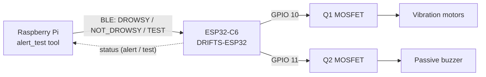
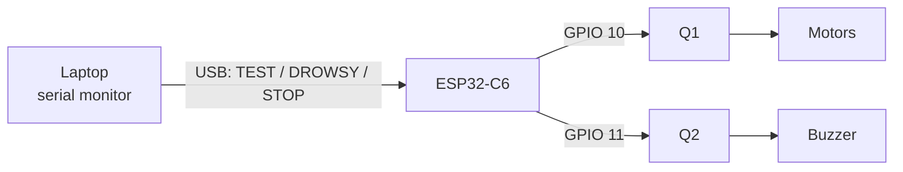

# Alert-Chain Test — Pi to Motor and Buzzer

Step-by-step bench test that proves the whole alert path works **before** any
drowsiness detection is involved:



> **The motor and buzzer are wired to the ESP32, not to the Pi.** The Pi has no
> wires to them and no data wires to the ESP32 either — the link is Bluetooth
> LE. "Is the Pi wired correctly?" for the alert chain means: does a command
> from the Pi make GPIO 10 and 11 on the ESP32 drive the motor and buzzer. That
> is what this test checks. The Pi's only physical connections are power, ground
> and the camera ribbon.

**Before wiring anything to GPIO 10/11, read [`Hardware/wiring-check.md`](../Hardware/wiring-check.md).**

---

## What you need

| Item | Notes |
| --- | --- |
| ESP32-C6 board, flashed with firmware from `esp32-first-compile` (commit with `TEST:` support) | See §1 |
| Raspberry Pi Zero 2 W + microSD (16 GB+) + 5 V supply | |
| Laptop on the same Wi-Fi as the Pi | For SSH |
| Motor driver (Q1 + D1 + motors) and buzzer driver (Q2 + piezo) built per `Hardware/schematic.md` | Or nothing at all for a meter-only test |
| Multimeter | For the steady-HIGH checks |
| Phone with nRF Connect | Optional, confirms the ESP32 is advertising |

---

## Alert-chain test — ESP32 only

The v3 firmware accepts the same commands over USB serial, so you can test the
ESP32, motor and buzzer from your laptop with the serial monitor. **No Pi, no
Bluetooth.** Use this first: it isolates the ESP32 → driver → load half of the
chain, so if it passes, any later failure is on the Pi / BLE side.



**Before powering the motor branch**, do the power-off checks in
[`Hardware/wiring-check.md`](../Hardware/wiring-check.md) §1 — D1 orientation
above all. For the first motor run use a current-limited bench supply
(5 V, 1 A limit) if you have one.

### 1. Flash v3 and open the monitor

From the folder holding the `.bin` (Windows; on macOS/Linux the port is
`/dev/cu.usbserial-*` or `/dev/ttyUSB0`):

```powershell
pip install esptool
python -m esptool --chip esp32c6 -p COM5 write-flash 0x0 drifts_c6_8M_uartchip_v3.bin
python -m serial.tools.miniterm --dtr 0 --rts 0 COM5 115200
```

Find the port with `python -m serial.tools.list_ports -v` — use the **CH343**
entry. Keep `--dtr 0 --rts 0`. Type `STATUS` + Enter to confirm the board answers.

### 2. Run the commands

Type each line and press Enter:

| # | Command | Expect | ☐ |
| --- | --- | --- | --- |
| 1 | `TEST:2000:0` | Motor runs 2 s, then `[TEST] Motor off` | ☐ |
| 2 | `TEST:0:2000` | Buzzer 2.7 kHz tone for 2 s | ☐ |
| 3 | `TEST:5000:5000:DC` | Motor runs 5 s; meter on GPIO 11 (black probe on GND) ≈ **3.3 V**, buzzer silent | ☐ |
| 4 | `DROWSY` | Full alert: motor 0.5 s on / 0.3 s off, buzzer beeping | ☐ |
| 5 | `STOP` | Both stop immediately | ☐ |
| 6 | `DROWSY`, then wait | Stops on its own at 20 s (safety cap) | ☐ |

Command format: `TEST:<motor_ms>:<buzzer_ms>[:DC]`

- `0` leaves that output off
- `:DC` holds the buzzer pin steady HIGH (silent, for a meter) instead of the tone
- Anything above `20000` ms is clamped to 20 s, so a typo cannot hold 5 V on 3 V motors

Every command echoes in the serial log, e.g.:

```
[TEST] Pin test from serial
[TEST] Motor GPIO 10: 2000 ms at duty 255/255 | Buzzer GPIO 11: 0 ms tone
[TEST] Motor off
```

### Without the Pi, two things differ

- The 3-second fail-safe applies **only while a Pi is connected**, so `DROWSY`
  runs the full 20 s here. That is expected, not a bug.
- This proves only the ESP32 half. The Pi → Bluetooth half is tested with
  `drifts.alert_test` in §5.

### If a step fails

| Serial shows | But | Look at |
| --- | --- | --- |
| `[TEST] Motor GPIO 10 ...` | motor does not run | Meter GPIO 10: ~3.3 V → driver (Q1, D1, motor rail). 0 V → wrong header pin |
| `[TEST] ... Buzzer ... tone` | silent | GPIO 11 ~1.6 V average → Q2 / piezo wiring. Sounds in DC but not tone → active buzzer, swap for passive |
| nothing after typing `TEST:...` | | Firmware older than v3, or the port/baud is wrong |
| board resets when the motor starts | | 5 V rail sag — `wiring-check.md` §2 |

Full fault table: [`Hardware/wiring-check.md`](../Hardware/wiring-check.md) §4.

---

## 1. Flash the ESP32 with the test-capable firmware

The `TEST:` command was added after the first flash. Re-flash first, or
option **T** in the tool does nothing.

```powershell
python -m esptool --chip esp32c6 -p COM5 write-flash 0x0 drifts_c6_8M_uartchip_v3.bin
python -m serial.tools.miniterm --dtr 0 --rts 0 COM5 115200
```

Confirm the ready line lists `TEST:m:b[:DC]`:

```
[MAIN] Ready. Commands: WAKE / DROWSY / NOT_DROWSY / STOP / BRAKE / STATUS / TEST:m:b[:DC]
```

Quick ESP32-only check, no Pi needed — type into the serial monitor:

```
TEST:3000:3000
```

Expect `[TEST] Motor GPIO 10: 3000 ms ...` then `[TEST] Motor off` / `[TEST] Buzzer off`
three seconds later. If that works, the ESP32 side is fine and anything that
fails later is the Pi or the BLE link.

---

## 2. Flash the Pi's SD card (skip if the Pi is already set up)

On your laptop, install **Raspberry Pi Imager** (raspberrypi.com/software).

1. **Device:** Raspberry Pi Zero 2 W
2. **OS:** Raspberry Pi OS (64-bit). *Lite* is fine — no desktop is needed
3. **Storage:** the microSD card
4. **Edit settings** (the gear / "Customise" step) — this is what makes SSH work on first boot:
   - Hostname: `drifts-pi`
   - Username / password: pick one and share it with the team
   - Wi-Fi: SSID, password, **country** (US). The Zero 2 W is **2.4 GHz only**
   - Services tab: **Enable SSH**, password authentication
5. Write, eject, insert into the Pi, power on. First boot takes 2–3 minutes.

---

## 3. SSH in

From the laptop (PowerShell, macOS or Linux terminal):

```bash
ssh <username>@drifts-pi.local
```

If `drifts-pi.local` does not resolve, find the Pi's IP in your router's
client list and use `ssh <username>@<ip>`. Accept the host-key prompt with `yes`.

---

## 4. Get the code and install

```bash
sudo apt update && sudo apt install -y git
git clone -b esp32-first-compile https://github.com/KendracNguyen/DRIFTS.git ~/drifts
cd ~/drifts/Raspberry
bash deploy/install.sh
```

`install.sh` installs the packages, creates `.venv`, and enables the `drifts`
service. When `main` has this work merged, drop `-b esp32-first-compile`.

Already cloned? Update instead:

```bash
cd ~/drifts && git pull && cd Raspberry && bash deploy/install.sh
```

---

## 5. Run the alert-chain test

The service holds the Pi's BLE link to the ESP32, so stop it for the test:

```bash
sudo systemctl stop drifts
cd ~/drifts/Raspberry
.venv/bin/python -m drifts.alert_test
```

Rehearse first without hardware if you like — same menu, simulated ESP32:

```bash
.venv/bin/python -m drifts.alert_test --sim
```

### The menu

```
  D  DROWSY      full alert: motor + buzzer pulse (≤20 s)
  N  NOT_DROWSY  stop everything
  T  TEST        hold motor / buzzer on for set durations
  S  STATUS      what the ESP32 reports right now
  Q  QUIT        stop outputs, save results, disconnect
```

After each action the tool asks you to confirm what you saw, felt or measured
(`y` / `n` / Enter to skip). Answers are saved to
`~/drifts_test_logs/alert_test_<date>_<time>.log` when you quit.

### Recommended order

| # | Action | Expect | If not |
| --- | --- | --- | --- |
| 1 | **S** | `alert=False test=False` | No telemetry: firmware too old, re-flash (§1) |
| 2 | **T**, motor `2`, buzzer `0` | Motor runs 2 s, then stops | `Hardware/wiring-check.md` → motor |
| 3 | **T**, motor `0`, buzzer `2`, mode **T**one | 2.7 kHz tone for 2 s | `wiring-check.md` → buzzer |
| 4 | **T**, motor `5`, buzzer `5`, mode **D**C | Meter on GPIO 11 vs GND ≈ **3.3 V** for 5 s; motor runs | Pin or ground problem |
| 5 | **D** | Motor pulses 0.5 s on / 0.3 s off, buzzer beeps, keeps going | Stops after ~3 s → heartbeat not reaching ESP32 |
| 6 | **N** | Both stop immediately | |
| 7 | **D**, then wait 20 s | Stops on its own at 20 s | That is the `MAX_ALERT_MS` safety cap — expected |
| 8 | **Q** | Outputs off, log printed | |

Durations are capped at **20 s** by both the tool and the firmware, so a typo
cannot hold the motors on indefinitely.

### Meter readings (black probe on ESP32 GND)

| Point | During TEST | Idle |
| --- | --- | --- |
| GPIO 10 (motor gate side of 100 Ω) | ≈ 3.3 V while `DROWSY_VIB_DUTY` is 255; ≈ 2.1 V average at 160 | 0 V |
| GPIO 11 in **DC** mode | ≈ 3.3 V | 0 V |
| GPIO 11 in **tone** mode | ≈ 1.6 V average (a meter cannot follow 2.7 kHz) | 0 V |
| Q1 drain (motor −) | ≈ 0.1–0.2 V while on | ≈ motor rail (5 V) |

### When done

```bash
sudo systemctl start drifts
journalctl -u drifts -f          # look for: Connected to ESP32 hub!
```

---

## Troubleshooting

| Symptom | Likely cause |
| --- | --- |
| `The drifts service is running ...` | `sudo systemctl stop drifts` first |
| `DRIFTS-ESP32 not found` | ESP32 unpowered, old firmware (pre-`DF71` UUIDs), or out of range. Check nRF Connect |
| Alert stops after about 3 s | Heartbeat not arriving: fail-safe fired. Check the serial log for `fail-safe: Pi silent` |
| Serial shows `[TEST] ...` but nothing moves | ESP32 side fine; the fault is in the driver circuit → wiring-check |
| Serial shows nothing when you press T | Old firmware without `TEST:`, or the BLE write did not land. Serial shows `Ignored unknown Pi message` if the firmware is old-but-recent |
| `bleak` import error | Run with `.venv/bin/python`, not system `python3` |
