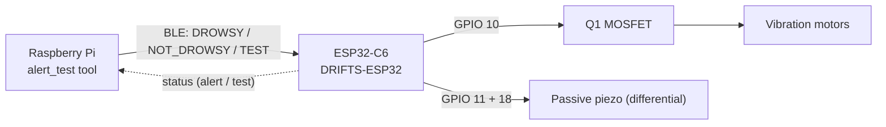
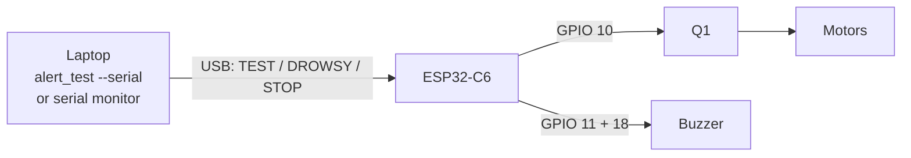
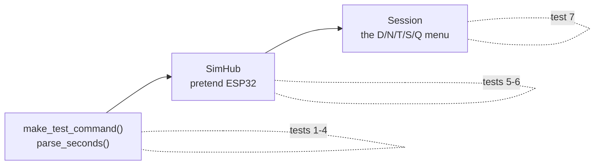

# Alert-Chain Test — Pi to Motor and Buzzer

Step-by-step bench test that proves the whole alert path works **before** any
drowsiness detection is involved:



> **The motor and buzzer are wired to the ESP32, not to the Pi.** The Pi has no
> wires to them and no data wires to the ESP32 either — the link is Bluetooth
> LE. "Is the Pi wired correctly?" for the alert chain means: does a command
> from the Pi make GPIO 10 and 11 on the ESP32 drive the motor and buzzer. That
> is what this test checks. The Pi's only physical connections are power, ground
> and the camera ribbon.

**Before wiring anything to GPIO 10/11, read [`Hardware/wiring-check.md`](../Hardware/wiring-check.md).**

---

## What you need

| Item | Notes |
| --- | --- |
| ESP32-C6 board, flashed with firmware from `esp32-first-compile` (commit with `TEST:` support) | See §1 |
| Raspberry Pi Zero 2 W + microSD (16 GB+) + 5 V supply | |
| Laptop on the same Wi-Fi as the Pi | For SSH |
| Motor driver (Q1 + D1 + motors) and piezo (R6/R7, GPIO 11 + 18) built per `Hardware/schematic.md` | Or nothing at all for a meter-only test |
| Multimeter | For the steady-HIGH checks |
| Phone with nRF Connect | Optional, confirms the ESP32 is advertising |

---

## Alert-chain test — ESP32 only

The firmware (v3 and later) accepts the same commands over USB serial, so you can test the
ESP32, motor and buzzer from your laptop — guided by the same tool the Pi uses, or by hand. **No Pi, no
Bluetooth.** Use this first: it isolates the ESP32 → driver → load half of the
chain, so if it passes, any later failure is on the Pi / BLE side.



**Before powering the motor branch**, do the power-off checks in
[`Hardware/wiring-check.md`](../Hardware/wiring-check.md) §1 — D1 orientation
above all. For the first motor run use a current-limited bench supply
(5 V, 1 A limit) if you have one.

### Walkthrough — guided test from your laptop

The same menu tool the Pi uses, pointed at the ESP32 over USB. It sends the
commands, shows what the ESP32 reports, asks you what happened, and saves a
pass/fail log. Allow 10 minutes.

**What you need on the laptop:** Python 3.11+, the repo (§*Get the repo* below),
the ESP32 on USB, and nothing else holding the COM port.

#### Step 1 — Flash the current firmware

From the folder holding the `.bin`:

```powershell
pip install esptool
python -m serial.tools.list_ports -v          # find the CH343 entry, e.g. COM5
python -m esptool --chip esp32c6 -p COM5 write-flash 0x0 drifts_c6_8M_uartchip_v9.bin
```

Wait for `Hash of data verified.` Any firmware from v3 on has the `TEST:`
command; use the newest.

#### Step 2 — Get the repo (once)

```powershell
cd C:\Users\<you>\Documents
Invoke-WebRequest -Uri https://github.com/KendracNguyen/DRIFTS/archive/refs/heads/esp32-first-compile.zip -OutFile drifts-repo.zip
Expand-Archive drifts-repo.zip -DestinationPath . -Force
cd DRIFTS-esp32-first-compile\Raspberry
```

Or `git clone -b esp32-first-compile https://github.com/KendracNguyen/DRIFTS.git`.
Re-run the two download lines whenever the code changes.

#### Step 3 — Rehearse with no hardware (optional, 1 minute)

```powershell
python -m drifts.alert_test --sim
```

Same menu against a pretend ESP32. Press **Q** to leave.

#### Step 4 — Start the guided test on the real ESP32

Close miniterm first — only one program can hold the port. Then:

```powershell
python -m drifts.alert_test --serial COM5
```

You should see the ESP32 answer:

```
Connected to the ESP32 on COM5 (USB serial). No Pi involved.
    ESP32| [STATUS] obd=scanning ... | pi=0 phone=0 | ...
```

Lines starting `ESP32|` are the board's own log.

#### Step 5 — Work through the menu in this order

| # | Press | Then type | You should see / feel | Answer |
| --- | --- | --- | --- | --- |
| 1 | **S** | — | `ESP32 status: alert=False test=False` | — |
| 2 | **T** | motor `2`, buzzer `0`, Enter | `ESP32\| [TEST] Motor GPIO 10: 2000 ms ...`; motor runs 2 s, then `Motor off` | `y` if it ran |
| 3 | **T** | motor `0`, buzzer `2`, Enter (tone) | 5 kHz tone for 2 s | `y` if heard |
| 4 | **T** | motor `0`, buzzer `5`, `d` (DC) | Silent. Meter: black probe on GND, red on GPIO 11 → **≈ 3.3 V** (GPIO 18 ≈ 0 V) for 5 s | `y` if ~3.3 V |
| 5 | **D** | — | `ESP32\| [MAIN] -> ALERTING`; motor pulses 0.5 s on / 0.3 s off, buzzer beeps | `y`, `y` |
| 6 | **N** | — | `ESP32\| [MAIN] -> IDLE`; both stop at once | `y` |
| 7 | **Q** | — | Sends `STOP`, closes the port, prints and saves the log | — |

No motor wired yet? Skip rows 2 and 5's motor question with Enter (recorded as
SKIP), or watch **GPIO 10 with a meter** instead: ≈ 3.3 V while on.
**Never connect the motor straight to GPIO 10** — always through Q1 with D1
(`Hardware/wiring-check.md`).

#### Step 6 — Read the result

```
Results saved to C:\Users\<you>\drifts_test_logs\alert_test_20261015_183457.log
DRIFTS alert-chain test 2026-10-15 18:34
hub: SerialHub

18:34:54  PASS  TEST: motor ran for about 2 s, then stopped?
18:35:10  PASS  TEST: buzzer sounded for about 2 s, then stopped?
18:35:31  PASS  TEST: meter read ~3.3 V on GPIO 11 for about 5 s, then stopped?
18:35:40  PASS  DROWSY: motor pulsing?
18:35:41  PASS  DROWSY: buzzer beeping?
18:35:50  PASS  NOT_DROWSY: both outputs stopped?

6 pass, 0 fail, 0 skipped
```

`hub: SerialHub` records that this was the USB test, not the Pi one. Keep the
log with the team's test records. A **FAIL** prints a pointer to
`Hardware/wiring-check.md`; the table under *If a step fails* below says where
to look.

### Manual alternative — type the commands yourself

If you would rather not install the repo, the same checks by hand in the
serial monitor:

```powershell
python -m serial.tools.miniterm --dtr 0 --rts 0 COM5 115200
```

| # | Command | Expect | ☐ |
| --- | --- | --- | --- |
| 1 | `TEST:2000:0` | Motor runs 2 s, then `[TEST] Motor off` | ☐ |
| 2 | `TEST:0:2000` | Buzzer 5 kHz tone for 2 s | ☐ |
| 3 | `TEST:5000:5000:DC` | Motor runs 5 s; meter on GPIO 11 (black probe on GND) ≈ **3.3 V**, GPIO 18 ≈ 0 V, buzzer silent | ☐ |
| 4 | `DROWSY` | Full alert: motor 0.5 s on / 0.3 s off, buzzer beeping | ☐ |
| 5 | `STOP` | Both stop immediately | ☐ |
| 6 | `DROWSY`, then wait | Stops on its own at 20 s (safety cap) | ☐ |

Command format: `TEST:<motor_ms>:<buzzer_ms>[:DC]`

- `0` leaves that output off
- `:DC` holds GPIO 11 HIGH and GPIO 18 LOW (silent, for a meter) instead of the tone
- Anything above `20000` ms is clamped to 20 s, so a typo cannot hold 5 V on 3 V motors

### Without the Pi, two things differ

- The 3-second fail-safe applies **only while a Pi is connected**, so `DROWSY`
  runs the full 20 s here. That is expected, not a bug.
- This proves only the ESP32 half. The Pi → Bluetooth half is the same tool
  run on the Pi without `--serial` (§5).
- There is no heartbeat over USB, and none is needed.

### If a step fails

| Serial shows | But | Look at |
| --- | --- | --- |
| `[TEST] Motor GPIO 10 ...` | motor does not run | Meter GPIO 10: ~3.3 V → driver (Q1, D1, motor rail). 0 V → wrong header pin |
| `[TEST] ... Buzzer ... tone` | silent | GPIO 11 and 18 ~1.6 V average → R6/R7 / piezo wiring. Sounds in DC but not tone → active buzzer, swap for passive |
| nothing after typing `TEST:...` | | Firmware older than v3, or the port/baud is wrong |
| board resets when the motor starts | | 5 V rail sag — `wiring-check.md` §2 |

Full fault table: [`Hardware/wiring-check.md`](../Hardware/wiring-check.md) §4.

---

## 1. Flash the ESP32 with the test-capable firmware

The `TEST:` command was added after the first flash. Re-flash first, or
option **T** in the tool does nothing.

```powershell
python -m esptool --chip esp32c6 -p COM5 write-flash 0x0 drifts_c6_8M_uartchip_v3.bin
python -m serial.tools.miniterm --dtr 0 --rts 0 COM5 115200
```

Confirm the ready line lists `TEST:m:b[:DC]`:

```
[MAIN] Ready. Commands: WAKE / DROWSY / NOT_DROWSY / STOP / BRAKE / STATUS / TEST:m:b[:DC]
```

Quick ESP32-only check, no Pi needed — type into the serial monitor:

```
TEST:3000:3000
```

Expect `[TEST] Motor GPIO 10: 3000 ms ...` then `[TEST] Motor off` / `[TEST] Buzzer off`
three seconds later. If that works, the ESP32 side is fine and anything that
fails later is the Pi or the BLE link.

---

## 2. Flash the Pi's SD card (skip if the Pi is already set up)

On your laptop, install **Raspberry Pi Imager** (raspberrypi.com/software).

1. **Device:** Raspberry Pi Zero 2 W
2. **OS:** Raspberry Pi OS (64-bit). *Lite* is fine — no desktop is needed
3. **Storage:** the microSD card
4. **Edit settings** (the gear / "Customise" step) — this is what makes SSH work on first boot:
   - Hostname: `drifts-pi`
   - Username / password: pick one and share it with the team
   - Wi-Fi: SSID, password, **country** (US). The Zero 2 W is **2.4 GHz only**
   - Services tab: **Enable SSH**, password authentication
5. Write, eject, insert into the Pi, power on. First boot takes 2–3 minutes.

---

## 3. SSH in

From the laptop (PowerShell, macOS or Linux terminal):

```bash
ssh <username>@drifts-pi.local
```

If `drifts-pi.local` does not resolve, find the Pi's IP in your router's
client list and use `ssh <username>@<ip>`. Accept the host-key prompt with `yes`.

---

## 4. Get the code and install

```bash
sudo apt update && sudo apt install -y git
git clone -b esp32-first-compile https://github.com/KendracNguyen/DRIFTS.git ~/drifts
cd ~/drifts/Raspberry
bash deploy/install.sh
```

`install.sh` installs the packages, creates `.venv`, and enables the `drifts`
service. When `main` has this work merged, drop `-b esp32-first-compile`.

Already cloned? Update instead:

```bash
cd ~/drifts && git pull && cd Raspberry && bash deploy/install.sh
```

---

## 5. Run the alert-chain test

The service holds the Pi's BLE link to the ESP32, so stop it for the test:

```bash
sudo systemctl stop drifts
cd ~/drifts/Raspberry
.venv/bin/python -m drifts.alert_test
```

Rehearse first without hardware if you like — same menu, simulated ESP32:

```bash
.venv/bin/python -m drifts.alert_test --sim
```

### The menu

```
  D  DROWSY      full alert: motor + buzzer pulse (≤20 s)
  N  NOT_DROWSY  stop everything
  T  TEST        hold motor / buzzer on for set durations
  S  STATUS      what the ESP32 reports right now
  Q  QUIT        stop outputs, save results, disconnect
```

After each action the tool asks you to confirm what you saw, felt or measured
(`y` / `n` / Enter to skip). Answers are saved to
`~/drifts_test_logs/alert_test_<date>_<time>.log` when you quit.

### Recommended order

| # | Action | Expect | If not |
| --- | --- | --- | --- |
| 1 | **S** | `alert=False test=False` | No telemetry: firmware too old, re-flash (§1) |
| 2 | **T**, motor `2`, buzzer `0` | Motor runs 2 s, then stops | `Hardware/wiring-check.md` → motor |
| 3 | **T**, motor `0`, buzzer `2`, mode **T**one | 5 kHz tone for 2 s | `wiring-check.md` → buzzer |
| 4 | **T**, motor `5`, buzzer `5`, mode **D**C | Meter on GPIO 11 vs GND ≈ **3.3 V** for 5 s; motor runs | Pin or ground problem |
| 5 | **D** | Motor pulses 0.5 s on / 0.3 s off, buzzer beeps, keeps going | Stops after ~3 s → heartbeat not reaching ESP32 |
| 6 | **N** | Both stop immediately | |
| 7 | **D**, then wait 20 s | Stops on its own at 20 s | That is the `MAX_ALERT_MS` safety cap — expected |
| 8 | **Q** | Outputs off, log printed | |

Durations are capped at **20 s** by both the tool and the firmware, so a typo
cannot hold the motors on indefinitely.

### Meter readings (black probe on ESP32 GND)

| Point | During TEST | Idle |
| --- | --- | --- |
| GPIO 10 (motor gate side of 100 Ω) | ≈ 3.3 V while `DROWSY_VIB_DUTY` is 255; ≈ 2.1 V average at 160 | 0 V |
| GPIO 11 in **DC** mode | ≈ 3.3 V | 0 V |
| GPIO 11 and 18 in **tone** mode | ≈ 1.6 V average each (a meter cannot follow 5 kHz) | 0 V |
| GPIO 18 in **DC** mode | ≈ 0 V | — |
| Q1 drain (motor −) | ≈ 0.1–0.2 V while on | ≈ motor rail (5 V) |

### When done

```bash
sudo systemctl start drifts
journalctl -u drifts -f          # look for: Connected to ESP32 hub!
```

---

## 6. Automated tests for the alert-chain tool (no hardware)

`Raspberry/tests/test_alert_test.py` checks the Pi-side tool
(`drifts/alert_test.py`) without a Pi, an ESP32 or Bluetooth. Run it after
changing the tool, and before every commit — it is part of
`cd Raspberry && python3 -m pytest -q`.

### Run it

On the Pi (from `~/drifts/Raspberry`):

```bash
.venv/bin/python -m pytest tests/test_alert_test.py -v
```

On a laptop (Python 3.11 or newer — it uses `tomllib`):

```powershell
cd <repo>\Raspberry
pip install pytest
python -m pytest tests\test_alert_test.py -v
```

Expected:

```
tests/test_alert_test.py::test_make_test_command_matches_firmware_format PASSED
tests/test_alert_test.py::test_make_test_command_fits_esp32_result_buffer PASSED
tests/test_alert_test.py::test_make_test_command_rejects_out_of_range[-1] PASSED
tests/test_alert_test.py::test_make_test_command_rejects_out_of_range[20.1] PASSED
tests/test_alert_test.py::test_parse_seconds PASSED
tests/test_alert_test.py::test_sim_hub_test_timing_and_stop PASSED
tests/test_alert_test.py::test_sim_hub_drowsy_then_not_drowsy PASSED
tests/test_alert_test.py::test_session_records_results_and_saves PASSED
tests/test_alert_test.py::test_serial_hub_tracks_pin_test_from_firmware_log PASSED
tests/test_alert_test.py::test_serial_hub_tracks_alert_state PASSED
tests/test_alert_test.py::test_serial_hub_sends_lines_and_skips_ping PASSED
tests/test_alert_test.py::test_serial_session_end_to_end PASSED
============================== 12 passed in 0.5s ===============================
```

### What each test proves

The tool has three layers (plus the USB transport, tests 8–11). The tests cover each one, from the bytes sent to
the ESP32 up to the whole menu session:



| # | Test | Proves | Why it matters |
| --- | --- | --- | --- |
| 1 | `test_make_test_command_matches_firmware_format` | 3 s / 2 s becomes `TEST:3000:2000`; 0.5 s becomes `500`; DC mode adds `:DC` | Must match exactly what `pin_test.h` on the ESP32 parses, or option **T** silently does nothing |
| 2 | `test_make_test_command_fits_esp32_result_buffer` | The longest command (`TEST:20000:20000:DC`, 19 chars) is under 24 bytes | The ESP32 copies Pi messages into a 24-byte buffer (`RESULT_MAX` in `ble_hub.cpp`). Longer would be cut off and rejected |
| 3 | `test_make_test_command_rejects_out_of_range` | −1 s and 20.1 s are refused, for both motor and buzzer | The 20 s cap protects 3 V motors from being held at 5 V. Runs twice (`[-1]`, `[20.1]`) |
| 4 | `test_parse_seconds` | Enter = default 3 s; spaces trimmed; `0` allowed; `-1`, `21`, `abc` refused | What the tester types at the prompts is validated before anything is sent |
| 5 | `test_sim_hub_test_timing_and_stop` | `TEST:2000:500` keeps the test active at 1 s (motor still on) and ends it by 2.5 s; logs `GPIO 10 HIGH for 2000 ms` | The pretend ESP32 used by `--sim` times each output separately, like the real firmware |
| 6 | `test_sim_hub_drowsy_then_not_drowsy` | `DROWSY` starts an alert that stops on its own after 20 s, and `NOT_DROWSY` stops it at once | Mirrors `MAX_ALERT_MS` and the stop path on the ESP32 |
| 7 | `test_session_records_results_and_saves` | Plays a full menu session: **T**, motor `2`, buzzer `1`, mode **d** (DC), answers **y** then **n**, **Q**. Checks `TEST:2000:1000:DC` was sent, results are `PASS, FAIL`, and the log file says `1 pass, 1 fail` | The whole tool end to end: prompts, command, recorded answers, saved log |
| 8 | `test_serial_hub_tracks_pin_test_from_firmware_log` | Reads the firmware's own `[TEST] Motor GPIO 10: 2000 ms ...` / `Motor off` / `Buzzer off` lines and tracks which output is on | `--serial` mode knows when a test is running from the ESP32's log, the same lines a person reads |
| 9 | `test_serial_hub_tracks_alert_state` | `[MAIN] -> ALERTING` / `-> IDLE` switch the alert flag | **S** over USB reports the real alert state |
| 10 | `test_serial_hub_sends_lines_and_skips_ping` | Commands go out as `TEST:3000:0\n`; the BLE heartbeat `PING` is not sent over USB; quitting sends `STOP` | The ESP32 console is line-based, and quitting always leaves the outputs off |
| 11 | `test_serial_session_end_to_end` | Full USB session: **T** (1 s motor), **D**, **N**, **Q** against a fake port that answers like the firmware; log says `hub: SerialHub`, `4 pass, 0 fail` | The ESP32-only walkthrough, end to end |

### How the tests avoid hardware and waiting

| Trick | Used in | What it replaces |
| --- | --- | --- |
| `SimHub` | 5, 6, 7 | The ESP32 over Bluetooth. Same `send()` / `status()` as the real `BleHub` |
| `FakeClock` | 5, 6 | Real time. The test moves the clock forward (`clock.t += 21`) instead of sleeping 21 s |
| Scripted `ask()` | 7 | A person typing. Answers come from a list: `["T", "2", "1", "d", "y", "n", "Q"]` |
| `no_sleep` | 7 | The tool's `asyncio.sleep` pauses, so the session finishes instantly |
| `spy` around `hub.send` | 7 | Records every message the tool sends, to check the exact command |
| `tmp_path` | 7 | A throwaway folder for the log file, so tests never write to `~/drifts_test_logs` |

### What these tests do **not** prove

- That Bluetooth works, that GPIO 10 / 11 switch, or that the motor and buzzer
  are wired correctly — that is §5 (Pi) or the ESP32-only section, on hardware.
- That the firmware accepts the command — that is `Esp32/test/test_pin_test.cpp`
  (`cd Esp32/test && make`), which tests the same `TEST:` format from the ESP32 side.

Tests 1–2 here and `test_pin_test.cpp` together pin the format from both ends.
If either side changes `TEST:<motor_ms>:<buzzer_ms>[:DC]`, one of them fails.

### When a test fails

| Fails | Likely cause |
| --- | --- |
| 1 or 2 | Someone changed the command format or `MAX_TEST_S`. Update `pin_test.h`, `ble_hub.cpp` `RESULT_MAX` and this tool together |
| 3 or 4 | Input validation changed; check the 0–20 s limits still hold |
| 5 or 6 | `SimHub` timing no longer matches the firmware's behaviour |
| 7 | The menu prompts or their order changed; update the scripted answers to match |
| `ModuleNotFoundError: drifts` | Run from the `Raspberry` folder, not `Raspberry/tests` |
| `ModuleNotFoundError: tomllib` | Python older than 3.11 |

---

## Troubleshooting

| Symptom | Likely cause |
| --- | --- |
| `The drifts service is running ...` | `sudo systemctl stop drifts` first |
| `DRIFTS-ESP32 not found` | ESP32 unpowered, old firmware (pre-`DF71` UUIDs), or out of range. Check nRF Connect |
| Alert stops after about 3 s | Heartbeat not arriving: fail-safe fired. Check the serial log for `fail-safe: Pi silent` |
| Serial shows `[TEST] ...` but nothing moves | ESP32 side fine; the fault is in the driver circuit → wiring-check |
| Serial shows nothing when you press T | Old firmware without `TEST:`, or the BLE write did not land. Serial shows `Ignored unknown Pi message` if the firmware is old-but-recent |
| `bleak` import error | Run with `.venv/bin/python`, not system `python3` |
