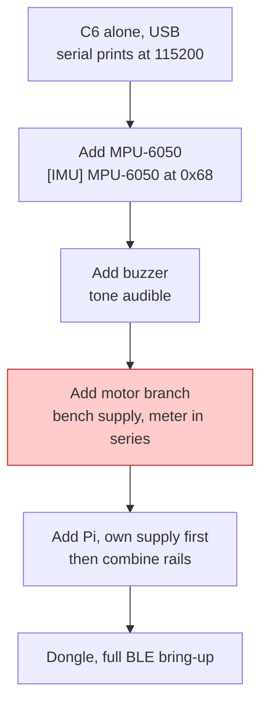

# Build and Deploy

**Tonight's milestone.** The firmware has never been compiled. Everything below
assumes that, so the first section is the one that decides how the evening goes.

The repo is an **Arduino sketch**, not PlatformIO and not ESP-IDF:
`Esp32/drifts_esp32/drifts_esp32.ino` with its headers beside it. Do not add a
`platformio.ini` tonight — changing the build system and compiling for the
first time are two unknowns, and you want one.

---

## 1. ESP32-C6 — toolchain

Three of these settings produce confusing failures rather than clear errors.

```bash
arduino-cli config init
arduino-cli config add board_manager.additional_urls \
  https://espressif.github.io/arduino-esp32/package_esp32_index.json
arduino-cli core update-index
arduino-cli core install esp32:esp32          # must resolve to 3.x — C6 support starts at 3.0.0
arduino-cli core list
```

```bash
arduino-cli lib install "NimBLE-Arduino@2.5.1"
arduino-cli lib install "ELMduino"
arduino-cli lib list
```

**NimBLE-Arduino 2.5.1 is the version this firmware was first compiled with**
(against esp32 core 3.3.12). 2.3.9 compiles but fails to link on core 3.3.x
(`undefined reference to r_os_memblock_get`). Versions before 2.3.9 crash when
scanning on the C6, which is the first thing this firmware does — so the
symptom is a reboot loop at startup with nothing pointing at the library.

`ELMduino` is used unmodified, through the `Stream` adapter in `ble_stream.h`.
Do not patch it.

### Board options

Do not copy an FQBN from anywhere. Print the real option IDs for your core
version:

```bash
arduino-cli board details --fqbn esp32:esp32:esp32c6
```

Set three things from that list:

| Option | Value | Why |
| --- | --- | --- |
| Flash Size | **8MB** | Default is 4MB and silently wastes half the part |
| Partition Scheme | **8M with spiffs**, or Huge APP | Uses the 8MB part. First build measured 770 KB, which would also fit the default 1.2MB app partition |
| USB CDC On Boot | **Disabled** (`CDCOnBoot=default`) on our board | Our N8 dev kit's single USB-C goes through a CH343 USB-serial chip, so `Serial` must stay on the UART. Enable it (`CDCOnBoot=cdc`) only on a board whose port is the C6's native USB (shows as *USB JTAG/serial debug unit*, VID 303A). The wrong setting flashes fine and then prints nothing |

Then build the FQBN from the IDs that command printed, for example:

```bash
arduino-cli compile \
  --fqbn esp32:esp32:esp32c6:FlashSize=8M,PartitionScheme=default_8MB,CDCOnBoot=default \
  Esp32/drifts_esp32
```

Leave `MYNEWT_VAL_BLE_MAX_CONNECTIONS` alone. The C6 controller is compiled
with `CONFIG_BT_LE_MAX_CONNECTIONS=3`; raising the host value achieves
nothing, because the host cannot exceed the controller.

### Before you power anything

```bash
python3 Hardware/check_pins.py        # must print: OK: 5 pins agree
cd Esp32/test && make                 # 28 assertions, runs on the laptop
cd Tools && python -m pytest obd_sim/tests obd_link/tests -q
```

Confirm nothing is wired to **GPIO 25 or 26**. On the C6 those are SPI flash
lines. `ledcAttach(26, …)` returns `true` and `digitalWrite(25, …)` runs — the
symptom is flash corruption or a boot loop with nothing pointing at the pins.
Motor is **GPIO 10**, buzzer is **GPIO 11**.

### Flash

```bash
arduino-cli upload -p /dev/ttyACM0 --fqbn <same fqbn> Esp32/drifts_esp32
arduino-cli monitor -p /dev/ttyACM0 -c baudrate=115200
```

On Windows the port is `COMn`. If the board is not enumerated, hold BOOT
(GPIO 9) while plugging in.

**Our dev kit (ESP32-C6-WROOM-1 N8, single USB-C)** has a USB hub on the
board, so one cable shows up as two ports:

| Port | `list_ports -v` shows | Use |
| --- | --- | --- |
| CH343 bridge | `USB-Enhanced-SERIAL CH343`, `1A86:55D3` | Flash and serial console. The firmware prints here |
| Native C6 USB | `USB Serial Device`, `303A:1001` | Unused with `CDCOnBoot=default` |

From Windows, without installing arduino-cli:

```powershell
pip install esptool
python -m esptool --chip esp32c6 -p COM5 write-flash 0x0 drifts_esp32.ino.merged.bin
python -m serial.tools.miniterm --dtr 0 --rts 0 COM5 115200
```

Keep `--dtr 0 --rts 0`: DTR/RTS drive the auto-reset circuit, and leaving them
asserted can hold the chip in reset or download mode with a silent console.

**Pressing RESET drops the COM port** on this board (`Access is denied` in
miniterm), even on a direct laptop port. The firmware keeps running; the port
re-enumerates. Reopen the monitor, or use a script that reconnects, to see the
boot banner. To check Bluetooth without serial at all, scan for
**DRIFTS-ESP32** in nRF Connect.

### Confirming the outputs actually assert

The alert path is driven by LEDC, so a multimeter on a PWM pin reads an
average, not a level. Check it like this:

| Command | Expect on GPIO 10 | Expect on GPIO 11 |
| --- | --- | --- |
| `DROWSY` | ~3.1 V average at 63 % duty, or 3.3 V if `DROWSY_VIB_DUTY` is still 255 | ~2.7 kHz square |
| `STOP` | 0 V | 0 V |

`DROWSY` must **hold** for the full 20 s (`MAX_ALERT_MS`). If it cuts off at
about 3 s you are running old firmware — the fail-safe used to fire when no Pi
had ever connected. Re-pull and reflash.

> `DROWSY_VIB_DUTY` in `config.h` is currently **255** — full 5 V into 3 V
> motors. Either change it to ~160 or fit the 27 Ω series resistors. Whoever
> wires the board and whoever sets that constant have to agree; the mismatch is
> invisible until the motors fail.

---

## 2. Raspberry Pi Zero 2 W

The deploy scripts already exist. Use them rather than installing by hand.

```bash
git clone <repo> ~/drifts && cd ~/drifts/Raspberry
bash deploy/install.sh
```

That script does all of: apt packages (`python3-picamera2`, `python3-opencv`,
`python3-numpy`, `bluez`), enables Bluetooth, adds the user to
`bluetooth,video,gpio`, creates `.venv` **with `--system-site-packages`**,
installs `requirements.txt`, then templates and enables
`deploy/drifts.service`.

The `--system-site-packages` flag is load-bearing: `picamera2`, `opencv` and
`numpy` come from apt, not pip, and a plain venv cannot see them.

### Verify

```bash
systemctl is-enabled drifts            # enabled
systemctl status drifts                # active (running)
journalctl -u drifts -f
```

Expect in the log:

```
Heartbeat started (1.0 s interval)
Scanning for ESP32 hub (DRIFTS-ESP32)...
Connecting to DRIFTS-ESP32 (xx:xx:xx:xx:xx:xx)...
Connected to ESP32 hub!
Subscribed to WAKE characteristic (DF710002-...)
```

`Heartbeat started` prints at startup whether or not the hub is reachable, so
it proves nothing on its own. **`Connected to ESP32 hub!` is the line that
matters.** On the ESP32 side, `STATUS` should then show `pi=1`. If the log
loops on `ESP32 not found`, check the hub shows as DRIFTS-ESP32 in nRF Connect
and that the Pi is on a commit with the `DF71...` UUIDs.

**No heartbeat reaching the ESP32 means alerts will cut out after 3 seconds.** The ESP32
fail-safe stops the alert if the Pi is silent longer than `FAILSAFE_MS`, and
`heartbeat_s = 1.0` in `config.toml` is what keeps it satisfied.

### Steering weave (gyro)

Steering comes from the MPU-6050 gyro, not OBD — desk test and road
calibration in [`steering-weave.md`](steering-weave.md). Serial: `GYRO`.

### Testing the OBD dongle link

From a laptop over USB, no Pi needed:
`cd Tools && python -m obd_link --port COM5 --mode car` —
see [`obd-ble-link-test.md`](obd-ble-link-test.md).

### Testing the alert chain

To test the ESP32, motor and buzzer alone from a laptop over USB, see
[Alert-chain test — ESP32 only](alert-chain-test.md#alert-chain-test--esp32-only).

To check that a command from the Pi drives the motor and buzzer on the ESP32,
use the menu-driven bench tool — walkthrough in
[`alert-chain-test.md`](alert-chain-test.md), wiring cautions in
[`../Hardware/wiring-check.md`](../Hardware/wiring-check.md).

```bash
sudo systemctl stop drifts
.venv/bin/python -m drifts.alert_test        # --sim to rehearse without hardware
```

### Maintenance mode

The unit has `ConditionPathExists=!/boot/firmware/drifts-maintenance`, so it
can be stopped from starting at boot without a shell:

```bash
bash scripts/maint.sh on       # stop auto-start
bash scripts/maint.sh off      # resume
```

Or put an empty file named `drifts-maintenance` on the SD card's boot
partition from any computer. That is the recovery path when the Pi will not
come up and there is no keyboard.

### Finding the ESP32

```bash
python Tools/ble_scan.py       # prints the MAC; put it in config.toml [ble] address
```

Setting `address` skips the name scan and connects measurably faster.

---

## 3. Bring-up order

Do not power everything at once. Each step isolates a failure the next would
hide.



Step D is where a missing flyback diode reveals itself cheaply. Confirm the
current matches expectation before connecting the motors to the shared rail —
see `Hardware/falstad/05_motor_driver_no_flyback.txt` for what happens
without it.

At step E, check the 5 V rail does not sag below 4.75 V under simultaneous
load. A rail that dips on motor switch-on is what reboots the Pi mid-demo, and
it looks like a software crash.

---

## 4. What a green build does not prove

- **Inference does not work.** `Raspberry/model/` has no trained weights.
  `detector.py` falls back to a heuristic returning `Open` at 0.85 for every
  input. The Pi answers `NOT_DROWSY` to every WAKE. The 5 Pi tests pass anyway
  because they assert the result is well-formed, not correct.
- **`GATE_BENCH_MODE = true`**, so the 65 km/h operating-domain gate is off and
  the trigger fires parked. No data collected in this state is valid road data.
- **Levels 3 and 4 do not exist.** No voice alert, no rest-stop routing.
