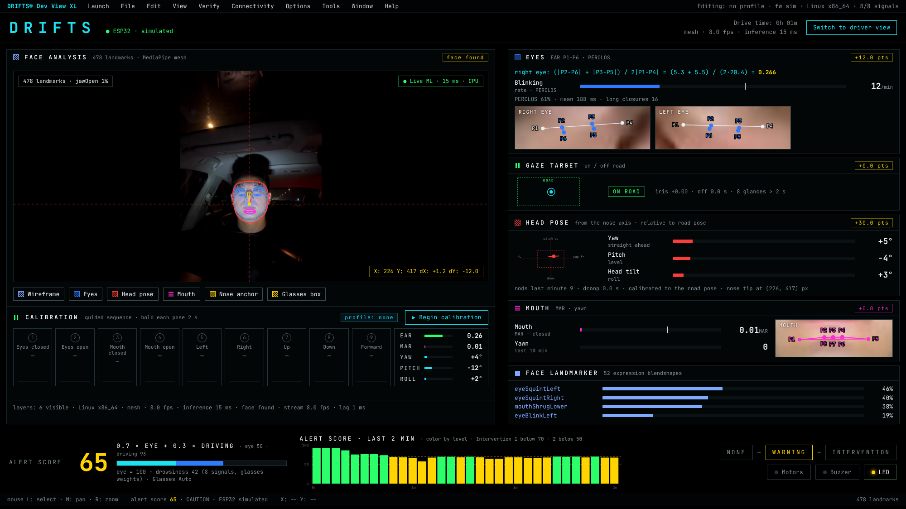

# Dev View XL: Full Face Analysis

A desktop page showing how DRIFTS reads the driver's face:
- the MediaPipe Face Landmarker mesh (478 points) drawn live over the camera
- every scored signal
- a guided calibration and an accuracy test

Open it at **`http://<address>:8080/dev`**, or with **Settings → Developer Mode**
in the phone app.



## Run the accuracy test on a laptop

Only the laptop's webcam is needed: no Pi, no ESP32.

```powershell
cd C:\Users\Kendra\Documents\School\Senior\DRIFTS\Raspberry
pip install mediapipe "opencv-python<5" bleak pyserial
python -m drifts.live --face mesh --camera 0 --esp sim --mirror --profile kendra
```
Open http://localhost:8080/dev in Chrome or Edge, full screen (F11), then:

1. **Check the mesh.**
   - The white wireframe should sit on your face, the blue lines on the eye lids, brows, irises and face outline, and the green lines on your lips.
   - Turn your head and open your mouth: the mesh should follow without lag.
   - The chip at the top right shows the inference time (ms) and **CPU** or **GPU**.
2. **Calibrate:** **▶ Begin calibration** (or Launch → Begin calibration), and enter your name.
   - Follow the prompt under the nine cards. Each pose must be **held for 2 s**: eyes closed, eyes open, mouth closed, mouth open, left, right, up, down, forward.
   - The card fills while you hold it, and turns green with the measured value.
   - A pose not reached within 20 s is skipped (orange).
   - At the end the profile is saved to `Raspberry/profiles/<name>.json` and applied straight away: your own eye scale, yawn threshold, off-road limits and road pose.
   - `--profile <name>` loads it next time.
3. **Accuracy test:** Launch → Run accuracy test. Seven prompts, 4 s each:
   - eyes open on the road
   - eyes closed
   - look left
   - look right
   - look down
   - mouth open
   - back to the road

   After a 1 s settle, every frame is scored: does DRIFTS classify the eyes (open / closed), the road (on / off) and the mouth (open / closed) the way it was asked?
4. **Read the result:** Verify → Show last report gives the accuracy per prompt and overall, and the report is saved to `Raspberry/logs/accuracy_<name>_<time>.json`.
   - Run it with and without glasses, and in dim light.
   - Run it before and after calibrating, to see what the profile changes.

> Laptop note: MediaPipe's GPU delegate isn't available in Python on
> Windows, so the laptop runs on the CPU (about 15–40 ms a frame).
> `--face-delegate gpu` tries the GPU on Linux / macOS and falls back to the CPU.

## The layout

| Area | Shows |
| --- | --- |
| Menu bar | **Launch** (calibration, accuracy test), **File** (download report, drowsiness history, status), **Edit** (copy status, copy the selected landmark), **View** (layers, mirror, reset zoom), **Verify**, **Connectivity** (ESP32 link, stream fps, lag), **Options** (glasses Auto / On / Off), **Tools** (beep the ESP32, re-take the road pose), **Window**, **Help** |
| Face analysis | camera + mesh, each landmark group in its legend colour: wireframe light blue, eyes / brows / irises blue, head pose (face oval, nose axis, crosshair) red, mouth magenta, nose anchor and glasses box yellow. Landmark count and jawOpen; inference time and delegate; nose-tip X / Y and its motion |
| Calibration | the nine pose cards, the live EAR / MAR / yaw / pitch / roll, the current prompt |
| Eyes | EAR formula worked through live, blink rate, PERCLOS, mean blink, long closures; **close-ups of both eyes with P1–P6 labelled** (P1 / P4 corners white, P2–P3 / P5–P6 blue) |
| Gaze target | where the driver is looking, against the dashed ROAD box; ON ROAD / OFF ROAD / EYES CLOSED |
| Head pose | yaw / pitch box and bars relative to the road pose, nods, droop |
| Mouth | MAR and the yawn count; **close-up with P1–P8 labelled** (P1 / P5 corners, P2–P8, P3–P7, P4–P6 openings), magenta |
| Face landmarker | the four strongest of the 52 blendshapes |
| Bottom bar | the **alert score** from the ESP32 (0.7 × eye + 0.3 × driving), coloured by level, with its eye / driving split and the drowsiness behind the eye part; the alert score over the session (bars green ≥ 70, yellow 50–69, red < 50, dashed lines at 70 and 50); NONE → WARNING → INTERVENTION; motors, buzzer, LED |
| Status bar | the alert score, and the selected landmark's index and normalised X / Y |

**Mouse:**
- Left click selects the nearest landmark.
- Middle drag (or Shift + drag) pans.
- Right drag or the wheel zooms.
- Double click resets the view.

Each panel's **pts** chip is that group's share of the composite drowsiness
score. The signal maths and weights are unchanged: see the tables below.

## How the mesh gets to the browser (and why)

The Pi does **not** draw the mesh. For every processed frame it sends:

| Stream | What | Size |
| --- | --- | --- |
| `/cam.mjpg` | the plain camera frame, JPEG quality 75 | ~25–40 KB a frame at 640 × 480 |
| `/face.sse` | 478 landmark x / y (0.1 px), inference ms, delegate, top blendshapes (Server-Sent Events) | ~5 KB a frame |
| `/status.json` | all signals, 4 times a second | ~6 KB |
| `/mesh.json` | the connection lists (tesselation, eyes, brows, irises, lips, face oval), once | 26 KB |

The page draws the mesh on a canvas, with the colours and line weights you choose.
The Pi only encodes one JPEG and sends numbers, so the old server-side overlay
and close-ups (`/dev.mjpg`, `/zoom.mjpg`, `/mouth.mjpg`) are no longer needed.
Those older streams still work, but nothing requests them any more.

### Next: the Pi broadcasts to the phone and a desktop at once

The same server already serves both views at the same time:
- the driver's phone on `/`
- a desktop on `/dev`

So in the car the Pi Zero can feed both, with the desktop drawing the analysis
and the Pi spending neither memory nor CPU on it. Plan:

1. **Measure:** run `drifts.live --face mesh --esp uart` on the Pi Zero with the phone on `/` and a desktop on `/dev`. Note:
   - camera fps and inference ms (header)
   - stream fps and lag (Connectivity menu, footer)
   - Pi CPU and memory (`top`)
   - Wi-Fi throughput: about 0.6 MB/s at 15 fps
2. **If the Zero struggles**, in this order:
   - Send landmarks every frame but JPEGs only every 2nd–3rd frame (the mesh stays smooth over a slower picture).
   - Pack landmarks as int16 binary (~2 KB a frame).
   - Lower the JPEG size or quality.
   - Use a WebSocket instead of SSE.
3. **Keep the phone light:** the phone app never opens the streams above. It reads `/status.json` and one small camera stream.

## The eight signals

| # | Signal | How it's measured | Flagged when |
| --- | --- | --- | --- |
| 1 | **Off-road gaze** | Iris position between the eye corners, plus head pose. Glances longer than 2 s are counted | Iris offset > 0.16, head off road, or eyes closed |
| 2 | **Yawn** | MAR held above the yawn threshold (0.50, or the calibrated one) for ≥ 1.5 s; counted over 10 min | Yawning |
| 3 | **Yaw** | Nose axis (MediaPipe's head-pose matrix); + = turned to the driver's right | Beyond the off-road limit (30°, or calibrated) |
| 4 | **Pitch** | Nose axis; + = looking down. A drop of ≥ 12° that comes back within 3 s is a **nod**; staying down > 2 s is **droop** | Droop |
| 5 | **Roll** | Nose axis; + = tilted toward the right shoulder | — |
| 6 | **Mouth aperture** | MAR = mean of inner-lip openings ÷ mouth width | — |
| 7 | **Eye openness** | EAR = (‖P2−P6‖ + ‖P3−P5‖) ÷ 2‖P1−P4‖ per eye, averaged | Eyes closed |
| 8 | **Blinking** | A closure of 50–500 ms is a blink → rate per minute, mean duration | Closed ≥ 1 s |

**Eye openness scale:**
- Without a profile, "closed" is measured against the driver's own open-eye EAR (the 85th percentile of the last minute).
- With a calibration profile, the measured open and closed EAR are used directly.
- PERCLOS (P80, 60 s) is the share of time the eyes are at least 80 % closed.

EAR P1–P6 use MediaPipe landmarks:

| | P1 | P2 | P3 | P4 | P5 | P6 |
| --- | --- | --- | --- | --- | --- | --- |
| Right eye | 33 | 160 | 158 | 133 | 153 | 144 |
| Left eye | 362 | 385 | 387 | 263 | 373 | 380 |

## Composite drowsiness score

Each signal becomes a part *d* from 0 (fine) to 1 (as bad as it gets). The
composite is the weighted sum, 0–100 (higher = drowsier). The ESP32 receives
**100 − composite** as `EYE:<n>`.

| Signal | d = 1 when | Weight | With glasses |
| --- | --- | --- | --- |
| EAR | PERCLOS 30 % | 0.30 | 0.12 |
| Blinking | mean blink 500 ms, or eyes shut 2 s | 0.15 | 0.06 |
| Gaze | irises off road for 3 s | 0.10 | 0.07 |
| Yaw | turned 40° from neutral (starts at 15°) | 0.05 | 0.08 |
| Pitch | 3 nods in a minute, or 3 s of droop | 0.15 | **0.30** |
| Head tilt (roll) | 30° from neutral (starts at 10°) | 0.05 | **0.12** |
| MAR | mouth hanging open, MAR 0.3 → 0.7 | 0.05 | 0.07 |
| Yawn | 3 yawns in 10 min; a yawn in progress counts at least 0.6 | 0.15 | 0.18 |

Glasses are detected from the edge strength across the nose bridge
(`GlassesDetector` in `drifts/facesignals.py`), or set with Options → Glasses.

## Files
| | |
| --- | --- |
| `Raspberry/drifts/devview.html` | the Dev View XL page (canvas mesh, panels, menus) |
| `Raspberry/drifts/facemesh.py` | MediaPipe Face Landmarker: landmarks, blendshapes, head-pose matrix; `packet()` for the stream |
| `Raspberry/drifts/facesignals.py` | the signal maths, EAR, blinks, PERCLOS, composite score |
| `Raspberry/drifts/guided.py` | guided calibration, profile, accuracy test |
| `Raspberry/drifts/live.py` | `/dev`, `/cam.mjpg`, `/face.sse`, `/mesh.json`, `/drowsy.json`, `POST /guided` |
| `Raspberry/drifts/static/fonts` | JetBrains Mono and Inter (SIL OFL), served by the Pi |
| `Raspberry/tests/test_guided.py`, `test_facesignals.py` | tests with synthetic landmarks (no camera) |
