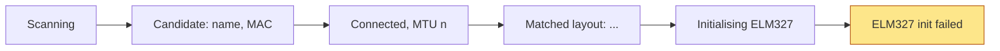

# OBD-II Dongle Bring-Up and Validation

**Owner:** Kendra · **Duration:** ~90 min · **Prerequisite:** firmware compiles and flashes

This is the diagnostic path for the physical dongle. It assumes the
architecture decided on Oct 14: **the ESP32-C6 is the BLE central to the
dongle. The Pi never talks to it.**

> **Quick automated check:** [`obd-ble-link-test.md`](obd-ble-link-test.md) runs the
> same stages from a laptop and prints PASS/FAIL. Use this page when a stage fails.

---

## Read this first — `rfcomm` will not work

A common plan is to bind the dongle to the Pi with `rfcomm`, then open it with
`screen` or `python-OBD`. That cannot work here, and the reason is worth
knowing before an hour goes into it.

`rfcomm` is **Bluetooth Classic** — the RFCOMM serial profile. The Veepeak
OBDCheck BLE+ and the Vgate iCar Pro BLE 4.0 are **Bluetooth Low Energy**
devices. They have no RFCOMM profile to bind to. `python-OBD` speaks to a
serial port, so it inherits the same problem.

The ESP32-C6 cannot bridge the gap either: it has **no Classic radio at all**.
A Classic ELM327 cannot work on this hardware under any firmware.

What replaces them:

| Instead of | Use |
| --- | --- |
| `rfcomm bind` | `bluetoothctl` scan, then `gatttool`/`bleak` for the GATT table |
| `screen /dev/rfcomm0` | `Tools/obd_sim --pty` for the serial habit, or the ESP32 serial log |
| `python-OBD` | `obd_ble.cpp` on the ESP32 — it is the OBD client |

---

## Phase A — Identify the dongle (20 min, laptop or Pi)

The firmware matches a dongle by advertised name, then probes four known GATT
layouts. Both can fail on an unknown dongle, and both are five-minute fixes
**if** you have the dongle's real UUIDs. Get them first.

```bash
bluetoothctl
> scan on          # find the dongle, note its MAC
> scan off
> exit
```

Then enumerate its services. From the repo:

```bash
python Tools/ble_scan.py          # lists everything advertising, DRIFTS flagged
```

For the full GATT table, nRF Connect on a phone is faster than anything on the
command line. Record:

- [ ] Advertised **name** (needs to match a string in `OBD_NAME_HINTS`, case-insensitive)
- [ ] **MAC address**
- [ ] **Service UUID** carrying the data channel
- [ ] The characteristic with **notify** — dongle → ESP32
- [ ] The characteristic with **write** — ESP32 → dongle (often the *same* one)

> **One central at a time.** A BLE dongle serves exactly one. If Torque, Car
> Scanner or nRF Connect is still connected, the ESP32 fails to connect with
> no useful error. Disconnect everything before Phase B.

If the layout is not one of the four in `LAYOUTS[]`, add it:

```c
// Esp32/drifts_esp32/obd_ble.cpp
{"<your dongle>", "<service>", "<notify char>", "<write char>"},
```

If the name is not matched, either add it to `OBD_NAME_HINTS` or set
`OBD_MAC_ADDRESS` in `config.h` to skip name matching entirely.

---

## Phase B — Dongle on a desk (25 min)

Dongle powered from any 12 V source, **not** in a car. This isolates the BLE
layer from the vehicle.

Watch the ESP32 serial console at 115200:



**`ELM327 init failed` at the end is the correct result here.** The dongle is
reachable but no vehicle is answering. Anything earlier in the chain is a real
fault.

| Stops at | Means | Do |
| --- | --- | --- |
| `Scanning`, no candidate | Name not matched | Add to `OBD_NAME_HINTS`, or set `OBD_MAC_ADDRESS` |
| `Connecting` forever | Another central holds it | Close the phone app; power-cycle the dongle |
| `Connected`, then `Dongle disconnected (reason 520)` | HCI 0x08: radio contact lost before discovery. Not a layout problem, whatever older firmware printed next | Firmware v5+; dongle powered and within ~2 m; no phone apps |
| `Discovering`, no layout | Unknown GATT family | The log lists every service with notify/write counts. Add it to `LAYOUTS[]` |
| `Matched layout`, then drops | MTU or notify subscription | Note the MTU in the log; try the fallback layout entry |

**Record:** which layout matched, the MAC, the negotiated MTU.

---

## Phase C — Simulator as a control (15 min)

Before blaming the car, prove the ESP32 side works against something that
definitely answers.

```bash
cd Tools && python -m obd_sim --ble        # advertises as OBDSIM-DRIFTS
```

If the ESP32 reaches `polling` against the simulator but not against the real
dongle, the fault is in discovery or the GATT layout, not in the ELM dialogue
or the poller. That halves the search.

If `--ble` will not start (see `Tools/obd_sim/README.md` — it is untested),
skip this phase rather than debugging it tonight.

---

## Phase D — Dongle in the car (35 min) ⭐

Car parked, **ignition on**. Engine running is better: idle RPM varies, which
the trigger can actually see.

1. Plug the dongle in. Power the ESP32 from a laptop or power bank.
2. Wait for `ELM327 ready` and the supported-PID line.
3. Wait 30 seconds, then type `STATUS`.

```
[STATUS] obd=polling layout=FFE0 8.4 Hz | rpm 780 (sd 42, n 58) spd 0 (sd 0.0, n 58) ...
```

| Field | Expect | If wrong |
| --- | --- | --- |
| `obd=` | `polling` | `scanning` → unreachable. `backoff` → read the drop reason above it |
| `hz` | **2–11** | `0.0` while `polling` → dongle connected, car not answering. Check ignition, then `ELM_PROTOCOL` |
| `n` | rising | Stuck at 0 → PIDs unsupported, or the parse is failing |
| `ovf` | **0** | Nonzero → frames dropped; any statistic from them is suspect |
| `gate` | `BENCH` | `closed` → you are not in bench mode |

**Write the `hz` number down.** It is vehicle-specific, gateways throttle it,
and the report should quote what was measured rather than a datasheet figure.

### Handshake and packet troubleshooting

| Symptom | Cause | Action |
| --- | --- | --- |
| `SEARCHING...` then a stall, up to 20 s | Protocol auto-detect | Normal once. Set `ELM_PROTOCOL = '6'` to skip it — already the default |
| `NO DATA` on one PID | Vehicle does not support it | Counted, not a fault. Check the supported-PID line |
| `NO DATA` on all PIDs | Wrong protocol, or ignition off | Try `ELM_PROTOCOL = '0'` once to let it auto-detect, then pin the result |
| `BUS INIT: ERROR` | Protocol mismatch | As above |
| `ovf` climbing | Notifications arriving faster than the ring buffer drains | Something is blocking in `loop()`. The C6 is single-core |
| `hz` collapses when the phone connects | Three BLE links competing | Expected to a degree. If it goes to zero, drop the phone link |
| Link drops every few minutes | Dongle sleep timer | Most have one. Note the interval; it bounds unattended test length |

---

## Phase E — Verify the IMU sign (10 min, needs a driver)

With someone else driving slowly and safely, brake firmly. Expect
`[IMU] Harsh brake: -0.4 g`.

If firm **acceleration** produces it instead, flip `IMU_LONG_SIGN` in
`imu.h`. Getting this backwards makes every brake count meaningless and
nothing else in the system will tell you.

---

## Log template

```
Date:                 Vehicle (year/make/model):
Dongle model:         MAC:
Advertised name:      GATT layout matched:
Negotiated MTU:       Achieved hz:          ovf:
Supported PIDs:   RPM __  SPEED __  THROTTLE __  LOAD __
Init failed on desk (expected Y):
Trigger fired:    Y / N    reason: ____________
IMU sign correct: Y / N    (flipped? Y / N)
Dongle sleep timeout observed:
Surprises:
```
