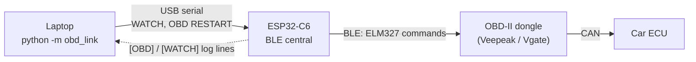

# OBD BLE Link Test — ESP32 ↔ ELM327 Dongle

Automated pass/fail test of the Bluetooth LE link between the ESP32-C6 and the
OBD-II dongle. Run it from a laptop over USB; it drives the ESP32's serial
console, grades every stage of the link, measures the real data rate, and saves
a report.



> **The ESP32 owns the dongle. The Pi never talks to it.** The dongle is
> Bluetooth **LE**, so `rfcomm`, `screen /dev/rfcomm0` and `python-OBD` cannot
> reach it from any computer — see [`dongle-bringup.md`](dongle-bringup.md).
> This test only needs the ESP32, the dongle and a laptop.

For deeper diagnosis of a failing stage (GATT tables, adding a new dongle to
`LAYOUTS[]`, protocol stalls), use [`dongle-bringup.md`](dongle-bringup.md).
This page is the quick, repeatable check.

---

## What it checks

| # | Stage | Passes when the ESP32 prints |
| --- | --- | --- |
| 1 | ESP32 scanning for a dongle | `[OBD] Scanning for a BLE OBD dongle...` |
| 2 | Dongle found (name + MAC) | `[OBD] Candidate: <name> (<mac>)` |
| 3 | BLE connected | `[OBD] Connected, MTU <n>` |
| 4 | GATT data channel matched | `[OBD] Matched layout: ...` |
| 5 | ELM327 initialised | `[OBD] ELM327 ready` |
| 6 | Vehicle PIDs reported | `[OBD] supported: RPM=1 SPEED=1 ...` |
| 7 | Live data flowing | `[WATCH] obd=polling hz>0` for 10 s in a row |

Two modes:

| Mode | Use when | Must reach | Note |
| --- | --- | --- | --- |
| `desk` | Dongle powered, **not** in a car | Stage 4 | `ELM327 init failed` is **EXPECTED** — no ECU is answering. This proves the radio and GATT layer |
| `car` | Dongle in the car, **ignition on** | Stage 7 | Engine running is better: idle RPM moves, the trigger can see it |

Run `desk` first if you can power the dongle off the car. A desk pass means any
later car failure is the vehicle side (ignition, protocol), not Bluetooth.

---

## What you need

| Item | Notes |
| --- | --- |
| ESP32-C6 flashed with **v5** firmware (`WATCH`, `OBD RESTART`, steadier dongle connection) | `drifts_c6_8M_uartchip_v5.bin` |
| BLE OBD-II dongle | Veepeak OBDCheck **BLE+** or Vgate iCar Pro **BLE**. A Classic-only ELM327 cannot work — the C6 has no Classic radio |
| Laptop with Python 3 and the repo | `pip install pyserial` (already there if you installed esptool) |
| USB cable to the ESP32 | The CH343 port (COM5 on Kendra's laptop) |
| Car with OBD-II port | For `car` mode. Parked, ignition on |

> ⚠ **One central at a time.** A BLE dongle serves exactly one connection.
> Close Torque, Car Scanner, OBD Fusion and nRF Connect on every phone nearby,
> or the ESP32 finds the dongle but cannot connect.

---

## 1. Flash v5 firmware

```powershell
python -m esptool --chip esp32c6 -p COM5 write-flash 0x0 drifts_c6_8M_uartchip_v5.bin
```

Optional check in the serial monitor — the ready line now ends with
`/ WATCH / OBD RESTART`:

```powershell
python -m serial.tools.miniterm --dtr 0 --rts 0 COM5 115200
```

**Close the monitor (`Ctrl+]`) before step 2.** Only one program can hold the port.

---

## 2. Run the test

From the repo's `Tools` folder:

```powershell
cd <path-to-repo>\Tools
python -m obd_link --port COM5 --mode desk     # dongle powered, not in a car
python -m obd_link --port COM5 --mode car      # dongle in the car, ignition on
```

The tool:

1. turns on `WATCH` (one line of live values per second)
2. sends `OBD RESTART` so the link is graded from a cold start
3. prints each stage as it passes
4. stops once the result is decided, or after 120 s
5. turns `WATCH` off, prints the report, and saves it to `obd_test_logs/`

Options:

| Flag | Default | Meaning |
| --- | --- | --- |
| `--timeout` | 120 | Seconds before giving up. Raise to 180 if `ELM_PROTOCOL` is `'0'` (auto-detect can stall ~20 s) |
| `--poll-seconds` | 10 | Seconds of live data required to pass `car` mode |
| `--no-restart` | off | Grade the link as it already is, without forcing a reconnect |
| `--log-dir` | `obd_test_logs` | Where reports go |

Exit code is `0` on PASS and `1` on FAIL, so it can be scripted.

### A passing car run looks like

```
  [PASS    ] ESP32 scanning for a dongle    <- [OBD] Scanning for a BLE OBD dongle...
  [PASS    ] Dongle found (name + MAC)      <- [OBD] Candidate: OBDII (aa:bb:cc:dd:ee:ff)
  [PASS    ] BLE connected to dongle        <- [OBD] Connected, MTU 247
  [PASS    ] GATT data channel matched      <- [OBD] Matched layout: FFF0 (generic ELM327 BLE)
  [PASS    ] ELM327 initialised             <- [OBD] ELM327 ready
  [PASS    ] Vehicle PIDs reported          <- [OBD] supported: RPM=1 SPEED=1 THROTTLE=1 LOAD=1
  [WATCH] obd=polling layout=FFF0 ... hz=8.4 rpm=780 spd=0 thr=14.5 load=22.0 nodata=0 err=0 ovf=0
  ...
  [PASS    ] Live data flowing (hz > 0)

  RESULT: PASS

Measured:
  dongle     OBDII  aa:bb:cc:dd:ee:ff
  MTU        247
  layout     FFF0 (generic ELM327 BLE)
  protocol   6
  PIDs       RPM=yes  SPD=yes  THR=yes  LOAD=yes
  rate       avg 8.2 Hz, min 7.1, max 9.0 over 10 s
  counters   nodata 0  err 0  ovf 0
```

**Record the measured rate.** It is vehicle-specific and the report should
quote it rather than a datasheet number. Expect **2–11 Hz** total across the
four PIDs.

---

## 3. Reading a failure

The report ends with **"Look first at:"** — the earliest stage that did not
pass, with the likely cause. Summary:

| Stuck at | Likely cause | Do |
| --- | --- | --- |
| 1 Scanning | No `[OBD]` output | Wrong port, old firmware, or the monitor still holds the port |
| 2 Found | Dongle not advertising or not recognised | Power it (ignition on). Close phone OBD apps. Unusual name → add to `OBD_NAME_HINTS`, or set `OBD_MAC_ADDRESS` in `config.h` |
| 3 Connected | Another central holds it | Close every phone app, power-cycle the dongle |
| 3 Connected, then `Dongle disconnected (reason 520)` | **HCI 0x08 — radio contact lost** right after connecting. Seen on the team's Veepeak on Oct 15 with v4 firmware, which then wrongly reported an unknown layout | Flash **v5** (longer link timeout, pauses advertising while connecting). ESP32 within ~2 m of the dongle, dongle properly powered, no phone apps |
| 4 Layout | Unknown GATT layout | The report lists the probed services — copy them into `LAYOUTS[]` in `obd_ble.cpp` |
| 5 ELM init (car) | ECU not answering | Ignition ON. Try `ELM_PROTOCOL = '0'` once with `--timeout 180` |
| 7 Live data, hz = 0 | Connected, no answers | Check `nodata`: climbing on every PID → wrong protocol |

Warnings that do not fail the test but matter:

| Warning | Meaning |
| --- | --- |
| `ovf=<n>` | Frames dropped in the BLE stream; something blocks `loop()`. Statistics from that run are suspect |
| Rate dipped below 2 Hz | Phone link competing for airtime, or weak signal |
| Vehicle does not support THR / LOAD | Not a link fault; the trigger uses the PIDs it has |
| Link dropped during the run | Note the reason; many dongles have a sleep timer |

---

## 4. Manual commands (no tool)

The same checks by hand in the serial monitor:

| Command | Does |
| --- | --- |
| `OBD RESTART` | Drop the dongle link and rescan from scratch |
| `WATCH` | Toggle a 1 Hz `[WATCH]` line: state, layout, hz, rpm, speed, throttle, load, counters |
| `STATUS` | One-shot full status, including the trigger windows and Pi/phone links |

---

## 5. Without a dongle

`Tools/obd_sim` is a virtual ELM327. Its `--pty` mode is tested (49 tests) and
proves the protocol; its `--ble` mode that would stand in for the dongle over
the air **has never been run on hardware** — if it misbehaves, do not sink
time into it. See [`Tools/obd_sim/README.md`](../Tools/obd_sim/README.md).

```bash
cd Tools && python -m obd_sim --ble        # advertises as OBDSIM-DRIFTS (untested)
python -m obd_link --port COM5 --mode car  # in another terminal
```

---

## Log template for the team

The saved report has everything below except the vehicle; add it at the top.

```
Date:              Tester:
Vehicle (year/make/model):
Dongle model:
Mode: desk / car        RESULT: PASS / FAIL
Rate avg / min (Hz):    ovf:    Supported PIDs:
Notes:
```
