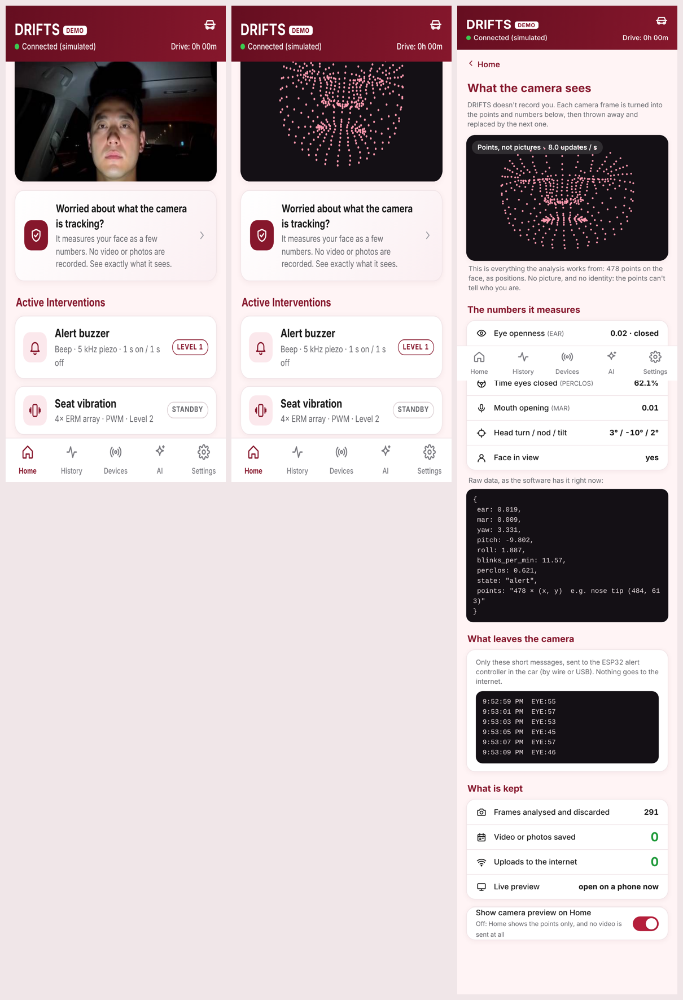

# Privacy and Data: What the Camera Does

People assume a driver camera records video. DRIFTS doesn't. This page says
exactly what happens to each frame. The phone app shows it live: tap **"Worried
about what the camera is tracking?"** on Home.

## What happens to a camera frame

1. **The camera takes a frame** (about 8–30 a second).
2. **MediaPipe finds 478 points on the face**: positions only, as x / y.
3. **DRIFTS turns the points into a few numbers:**
   - eye openness (EAR)
   - mouth opening (MAR)
   - head yaw / pitch / roll
   - blinks per minute
   - PERCLOS (the share of time the eyes are closed)
4. **The frame is dropped.** It lives in memory for a fraction of a second and is replaced by the next one. It is never written to disk.
5. **Short messages go to the ESP32 alert controller** in the car (by wire or USB), and nothing else leaves the camera:
   - `EYE:<0-100>` every 2 s
   - `DROWSY` / `NOT_DROWSY` when the face looks drowsy, or alert again

## What is kept

| Kept | What | Where |
| --- | --- | --- |
| **Never** | video, photos, the 478 points | — |
| Per drive | start time, length, average alertness score, number of alerts | `Raspberry/logs/trips.json` (History tab) |
| If you calibrate | your open / closed EAR, yawn threshold, head-turn limits, road pose: numbers | `Raspberry/profiles/<name>.json` |
| If you run the accuracy test | the per-prompt accuracy | `Raspberry/logs/accuracy_*.json` |
| **Only if you record it** | **your name, in your voice** (about 1 s), played back when the LCD recognises you | `Raspberry/profiles/<name>_name.wav` (Driver Profile → Delete) |
| **Only if you press it** | **Training Capture** (Settings) saves photos to teach the eye model | `Raspberry/captures/` |

Training Capture is the one feature that saves pictures. It only saves when its
buttons are pressed, and the privacy panel counts every saved photo ("Video or
photos saved").

## Choosing the driver by voice

At start-up the LCD asks "Who's driving? Say your name." The speech recogniser
(Vosk) runs on the Pi, offline, and only listens for the driver names and
"guest". **What it hears is not saved.** The only recording kept is the one you
choose to make in Settings → Driver Profile, so DRIFTS can greet you in your own
voice; the privacy page lists it and Driver Profile deletes it.

During the face check that follows, the camera picture shows **on the LCD only**,
to help you sit in the frame, and is not saved or sent.

## The live preview

The camera picture on Home is a **live view, not a recording**:
- **It is made only while a phone has the page open.** The Pi stops producing preview frames within 3 s of the page closing.
- **It goes only to a phone on the car's own Wi-Fi**, never to the internet.
- **It can be switched off:** privacy panel → **Show camera preview on Home** off. Home then shows the face points only, and no picture is sent at all.

## What DRIFTS does not do

- **No face recognition:** the points describe eye, mouth and head movement, not who you are.
- **No cloud:** everything runs on the Pi in the car.
- **No sharing:** nothing is sent anywhere except the alert messages to the ESP32.

## Where this is in the code

| | |
| --- | --- |
| `Raspberry/drifts/live.py` | `privacy()` and `/privacy.json`: the numbers, the points, messages sent, counters; the preview is only encoded while `/stream.mjpg` is watched |
| `Raspberry/drifts/dashboard.html` | the Home card, the privacy page, the preview switch |
| `Raspberry/tests/test_privacy.py` | no image data in `/privacy.json`; saved photos are counted |
