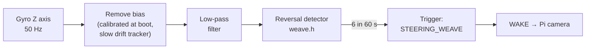

# Steering Weave — Gyro Instead of OBD

Detects the drift-and-correct steering pattern of a drowsy driver from the
**MPU-6050 gyroscope on the ESP32**, not from the car.

> **Why not OBD?** Standard OBD-II has no steering-angle or brake-pedal PID.
> They exist only as manufacturer-specific diagnostics (Audi "Mode 22"), which
> are undocumented, may be blocked by the gateway, and would share the dongle's
> **4–5 requests/s** (measured on the A5) with RPM, speed, throttle and load.
> The gyro measures how the car actually turns, at **50 Hz**, on any vehicle,
> with no extra load on the dongle.

| Signal | Source | Rate | Status |
| --- | --- | --- | --- |
| Harsh braking | MPU-6050 accelerometer (longitudinal) | 50 Hz | Existing |
| **Steering weave** | **MPU-6050 gyro (yaw rate)** | 50 Hz | **New** |
| RPM, speed, throttle, load | OBD dongle | ~1 Hz each | Existing |

No new hardware: the MPU-6050 already on GPIO 21 / 22 has a gyro that was unused.

---

## How it works



A **steering reversal** is the yaw rate swinging past **+2 °/s** and then past
**−2 °/s** (or the reverse) within **2 s**. In plain terms: the car turned one
way, then was quickly corrected the other way.

| Driving | Yaw rate | Counted? |
| --- | --- | --- |
| Normal lane keeping | ±1 °/s wobble | No — inside the ±2 °/s dead band |
| Drowsy drift + jerk correction | ±3–6 °/s, 1–3 s apart | **Yes** |
| Long steady curve | constant 5–10 °/s | No — never swings to the other side |
| S-bends on a highway | slow swing, > 2 s through the band | No |
| Lane change | one left-right | Counts once; the trigger needs 6 |

**Trigger:** 6 reversals within 60 s → `STEERING_WEAVE` → the ESP32 wakes the
Pi to check the driver's eyes, exactly like `HARD_BRAKES`. It respects the
same speed gate and 30 s cooldown.

At 100 km/h, 2 °/s of yaw is about 0.1 g of sideways acceleration — a real
correction, not road noise.

> ⚠ **These are starting values, not calibrated ones.** They come from vehicle
> dynamics, not from our car. See *Calibrating on the road* below.

All values live in `Esp32/drifts_esp32/config.h`:

```cpp
constexpr float    STEER_REVERSAL_DPS     = 2.0f;   // dead band, deg/s
constexpr uint32_t STEER_REVERSAL_MAX_MS  = 2000;   // max time for the swing
constexpr int      STEER_REVERSAL_TRIGGER = 6;      // reversals to trigger
constexpr int      STEER_WINDOW_S         = 60;     // rolling window
```

---

## Mounting the MPU-6050

The gyro measures rotation around the axis pointing **straight up** when
mounted. The firmware assumes the breakout lies **flat** (chip facing up or
down), so yaw is the **Z** axis.

| Mounting | Set in `imu.h` |
| --- | --- |
| Flat on the dash / console (default) | `IMU_YAW_AXIS = 2` |
| Standing on edge, Y axis vertical | `IMU_YAW_AXIS = 1` |
| Standing on edge, X axis vertical | `IMU_YAW_AXIS = 0` |

- **Mount it rigidly.** Foam tape or a loose board adds vibration that looks like steering.
- **Keep the car still for ~1 s at power-up** — that is when the gyro offset is measured.
  The boot log prints it: `[IMU] Longitudinal bias 0.012 g, yaw bias -0.43 deg/s`.
- `IMU_YAW_SIGN` only changes the logged direction (+ = left turn when correct);
  reversal counting uses both directions, so it is not critical.

---

## Desk test (no car)

ESP32 with the MPU-6050 wired, serial monitor open:

```powershell
python -m serial.tools.miniterm --dtr 0 --rts 0 COM5 115200
```

1. Leave the board still 2 s after reset (bias calibration).
2. Type `GYRO` — a line every 0.2 s:
   ```
   [GYRO] yaw=+0.1 deg/s  reversals=0  long=+0.00 g
   ```
   At rest, `yaw` should stay within about **±0.5**. Larger and drifting → board
   moved during calibration; reset with it still.
3. **Twist the board back and forth** flat on the desk, about a quarter turn
   each way, once a second. Expect:
   ```
   [IMU] Steering reversal #1 (yaw -38.2 deg/s)
   [IMU] Steering reversal #2 (yaw +41.0 deg/s)
   ```
4. Do it **six times within a minute** — with `GATE_BENCH_MODE = true` the trigger fires:
   ```
   [TRIGGER] [BENCH] STEERING_WEAVE -> waking Pi
   ```
5. Turn it **slowly** one way and hold it: no reversal. That is the "long curve" case.
6. `STATUS` shows `steer <count> yaw <deg/s>`; `GYRO` again turns the lines off.

| Check | ☐ |
| --- | --- |
| Yaw at rest within ±0.5 °/s | ☐ |
| Quick twists counted, one per direction change | ☐ |
| Slow turn-and-hold not counted | ☐ |
| Six twists in 60 s → `STEERING_WEAVE` | ☐ |

---

## Calibrating on the road

**A passenger runs the laptop. The driver only drives — never test weaving
deliberately on a public road.** Record normal driving and let the numbers say
where the thresholds should be.

1. Mount the board as it will be in the final build; power up with the car still.
2. Serial monitor, `GYRO` on, and log to a file:
   ```powershell
   python -m serial.tools.miniterm --dtr 0 --rts 0 COM5 115200 | Tee-Object steer_drive.log
   ```
3. Drive **20 minutes of normal highway** (above 65 km/h), plus some curves and lane changes.
4. Count the `[IMU] Steering reversal` lines per minute of alert driving.

| Normal driving shows | Adjust |
| --- | --- |
| 0–2 reversals per minute | Thresholds are about right |
| 3+ per minute in normal driving | Too sensitive: raise `STEER_REVERSAL_DPS` to 2.5–3.0, or `STEER_REVERSAL_TRIGGER` to 8 |
| Lane changes always count 2+ | Expected; the trigger needs 6 |
| Never any, even on bumpy roads | Check the axis (`IMU_YAW_AXIS`) — the `GYRO` line should move in curves |

Write the measured baseline in the team log. **The report should quote these
measured numbers, not the starting values above.**

`GATE_BENCH_MODE` must be `false` for road data — in bench mode the trigger
fires at any speed, including parking lots and intersections where steering
reversals are normal.

---

## Limitations

- **Yaw is the car's response, not the steering wheel.** Small wheel movements
  that do not turn the car are invisible. For fatigue weaving this is fine — the
  weave is what matters.
- **Road shape:** tight winding roads produce genuine reversals. The 65 km/h
  production gate keeps the trigger to highways, where this is rare.
- **Gyro drift:** the MPU-6050 offset shifts as it warms. The slow tracker
  (≈40 s) follows it; a 1–6 s weave is far faster and is not cancelled.
- **Thresholds are uncalibrated** until the road procedure above is done.
