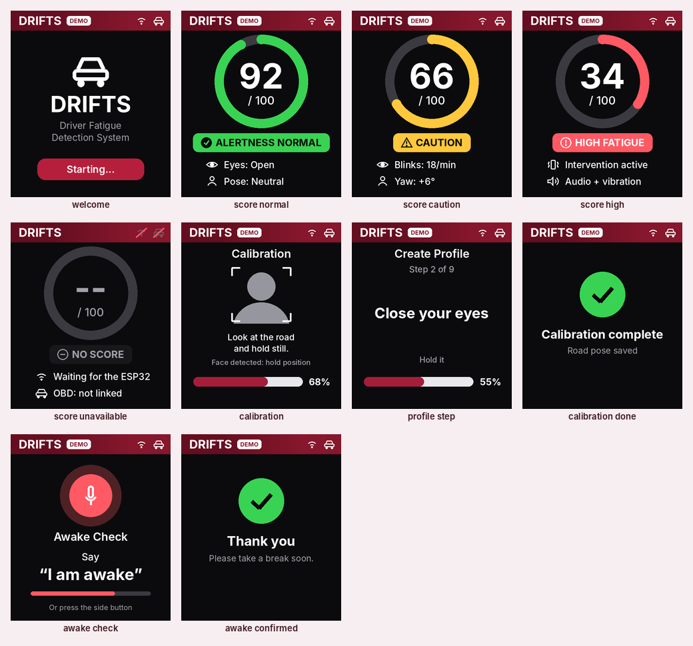
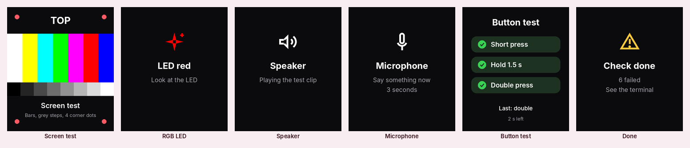
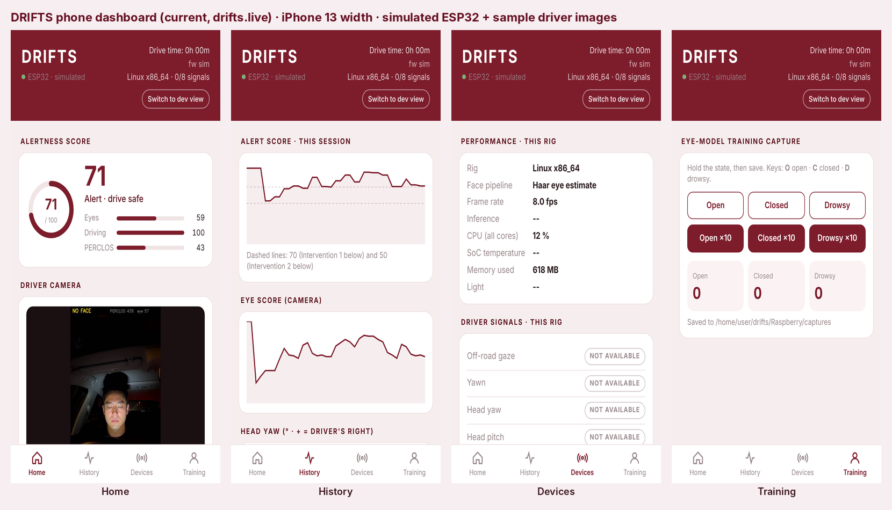

# Whisplay HAT: Bring-up and Implementation Plan

The software for the first model's driver display is finished and tested
against a simulated HAT. This page covers four things:
- **The LCD:** what it shows and when. It is a status display; the driver uses the phone app.
- **Day 0 and Day 1:** getting the code onto the Pi, then testing the camera and the LCD, step by step.
- **The side button:** screen brightness, plus developer actions.
- **The plan:** what comes after the screen works.

The hardware datasheet is in [`../Hardware/whisplay-hat.md`](../Hardware/whisplay-hat.md).

## Status

| Part | Code | Tested |
| --- | --- | --- |
| Screen: welcome, score (4 bands), calibration (quick / profile step / complete), "Say 'I am awake'" (asking / thank you); picks itself | `drifts/whisplay_ui.py` | simulated; PNGs in `Hardware/drawings/whisplay_screens.png` |
| RGB LED: green / yellow / red 1 s / red slow blink / blue | `led_color()` | simulated |
| Voice: clips on level changes, lost links, a finished calibration and the awake check | `VoiceDirector`, `Speaker` | simulated; clips play on a laptop |
| Calibration started in the phone app shows on the LCD | `Pipeline.calib_ui()` → `UiState.calibrating` | simulated with `drifts.live --whisplay-sim` |
| Awake check (Level 3): an alert lasting 20 s asks "Say 'I am awake'" | `WhisplayUI.ask_awake()` / `confirm_awake()` | simulated; the voice reply itself is phase 4 |
| **Side button:** short press = brightness (10 / 30 / 50 / 70 / 100 %, remembered); long / double for developers; each mapped in `config.toml` | `ButtonDecoder`, `WhisplayUI.do()`, `set_brightness()` | simulated (31 Whisplay unit tests in all) |
| Joy version: 5-way joystick (centre = the button, up / down = brightness). **Ours is the plain version** | `joystick = true` | simulated |
| Screen rotation: `rotate` = 0, 90, 180 or 270 degrees clockwise. At 90 / 270 the screens are scaled to fit the sideways 280 × 240 view (~14 % smaller) | `rotate = 90`, `orient()` | simulated; 90 confirmed wanted on our mount |
| Clean shutdown: screen and LED off | `WhisplayUI.close()` | simulated |
| Bring-up self-test | `python -m drifts.whisplay_check --hw` | simulated |
| Installer: PiSugar driver, gpiod, spidev, groups, font | `WHISPLAY=1 bash deploy/install.sh` | not run on a Pi yet |
| Copy from the laptop: `Raspberry` + `Voice` to `~/drifts` | `Raspberry/deploy/deploy.ps1` | not run on a Pi yet |

**Checked against PiSugar's own driver** (`runtime/whisplay.py` in
github.com/PiSugar/Whisplay, read Nov 2026):
- **Pins:** DC 27, RST 4, backlight 22, RGB 25 / 24 / 23, button 17. They match our pinout.
- **Button:** read every 5 ms. HIGH means pressed, and the callbacks take no arguments.
- **RGB LED:** `set_rgb(r, g, b)` takes 0–255 and inverts for the active-low LED itself.
- **Backlight:** PWM dimming on the Pi Zero 2 W (on/off only on the original Zero).
- **Screen:** 240 × 280 with 20 px rounded corners; `draw_image` takes our big-endian RGB565 bytes.
- **Not installed by default:** PiSugar's optional **`whisplay-daemon`** (app launcher) and
  **`whisplay-ai-chatbot`** (`chatbot.service`). Either one takes exclusive control of the screen, LED
  and button. DRIFTS refuses to start while one is running, and the installer disables both.

## The LCD: a status display

The driver never has to touch the screen. It changes by itself:

| When | Shows |
| --- | --- |
| Starting (4 s) | **Welcome**: DRIFTS, "Starting..." |
| Always, after that | **Score**: the alertness ring (green 70+, yellow 50–69, red below 50, grey with no data) and two lines under it |
| The driver starts a calibration **in the phone app** (Settings → Calibration) | **Calibration**: quick road pose ("Look at the road"), or the 9-pose profile / accuracy test (the current pose in large text, step *n* of 9, a hold bar). Then **"Calibration complete"** for 3 s and the voice says so |
| An alert has lasted 20 s (`awake_after_s`) | **"Awake Check: say 'I am awake'"** with a countdown, for 10 s (`awake_window_s`), and the voice asks. Then **"Thank you"** for 2.5 s once answered. It asks again 20 s later if the alert goes on |

An alert always wins over a calibration. The automatic road-pose pass at
start-up does **not** take over the screen: only a calibration the driver asked
for does.

**Answering "I am awake".** Speech recognition is phase 4 (below). Until then,
any press of the side button answers it, and the screen says "Or press the side
button". When a recogniser exists it is plugged in as
`WhisplayUI(hooks={"listen": start})` and calls `ui.confirm_awake(now)`; the
screen then says "Listening...". Answering never stops the ESP32's buzzer or
motors: they follow the alert score.

### Screens to check against

- **LCD**, every screen with example data:
  
- **Bring-up check** screens (`whisplay_check --hw`):
  
- **Phone app** (`drifts.live`, iPhone 13 width), the same design and alertness colours:
  

Regenerate: `python -m drifts.whisplay_ui --gallery --out <folder>` and copy its
`whisplay_screens.png` to `Hardware/drawings` (LCD), and
`python -m drifts.whisplay_check --hw --sim` (self-test). The phone screenshots are taken with
Playwright from `drifts.live --esp sim --video Simuletic_DMS_Dataset/images`.

---

## Day 0: get the Pi ready (about 45 minutes, most of it waiting)

1. **Flash the SD card** with Raspberry Pi Imager: **Raspberry Pi OS Lite (64-bit)**.
   In the Imager's settings (the gear):
   - Hostname `drifts`, user `drifts` and a password.
   - Your Wi-Fi (the phone's hotspot works for the car).
   - **Enable SSH**.
2. **Connect the camera** (Pi off): the **Camera Module 3 NoIR** on a Pi Zero camera cable (narrow 22-pin end in the Pi; the camera's own cable doesn't fit). Contacts towards the board at both ends. See [`../Hardware/camera-ir.md`](../Hardware/camera-ir.md).
3. **Boot, then check SSH** from the laptop: `ssh drifts@drifts.local`.
4. **Copy DRIFTS and install** (on the laptop, PowerShell, in the `DRIFTS-repo` folder). One of these:
   ```powershell
   # A. copy from the laptop (no GitHub login needed on the Pi)
   powershell -ExecutionPolicy Bypass -File .\Raspberry\deploy\deploy.ps1 -Install -Mesh -Whisplay
   ```
   ```bash
   # B. or clone on the Pi
   git clone https://github.com/KendracNguyen/DRIFTS.git ~/drifts
   cd ~/drifts/Raspberry && MESH=1 WHISPLAY=1 bash deploy/install.sh
   ```
   Either way the Pi ends up with `~/drifts/Raspberry` (the app) and
   `~/drifts/Voice` (the clips). The install takes 15–30 min on a Zero 2 W:
   - the wired ESP32 link (UART on, Bluetooth off),
   - the Python environment,
   - MediaPipe and its face model (`-Mesh` / `MESH=1`),
   - the Whisplay driver (`-Whisplay` / `WHISPLAY=1`),
   - the `drifts` service, which starts on every boot.
   Without the HAT fitted yet, leave out `-Whisplay` and run it again later.
5. **Reboot** (`sudo reboot`): the UART and the HAT's sound card need it.
6. **Camera check** (no HAT needed):
   ```bash
   sudo systemctl stop drifts                 # the service holds the camera
   cd ~/drifts/Raspberry
   rpicam-hello --list-cameras                # lists imx708_noir
   .venv/bin/python -m drifts.camera_check    # 20 s: camera, NoIR, frame rate, face found, focus, light
   ```
   Every line should be PASS (the [checks are explained here](../Hardware/camera-ir.md#camera_check-the-bring-up-test)).
   **Frame rate (with face mesh)** is the first measurement for the Pi Zero face-mesh goal.
7. **Camera and phone together:**
   ```bash
   .venv/bin/python -m drifts.live --face mesh --esp sim
   ```
   Open **http://drifts.local:8080** on the phone (same Wi-Fi):
   - The camera card shows your face with the outline (eyes green when open, red when closed).
   - **Settings → Calibration → Quick calibrate**: the calibration runs.
   - Stop with Ctrl-C, then `sudo systemctl start drifts`.

Later updates: run `deploy.ps1` without `-Install`, or `git pull` on the Pi
and `sudo systemctl restart drifts`.

---

## Day 1: the HAT arrives (about 30 minutes)

1. **Fit the HAT.**
   - Power the Pi off.
   - Press the HAT onto all 40 header pins, straight and fully down.
   - Set the speaker switch to **onboard**.
   - Ours is the **plain** version (no joystick), **V2**, with the **WM8960** codec (Amazon B0H4VGZZRK).
2. **Install the driver** (do any `apt full-upgrade` and reboot **first**: PiSugar's installer builds the
   sound driver only for the kernel that's running, so a later kernel update loses it; re-run
   `cd ~/Whisplay && sudo bash install_driver.sh` and reboot if that happens. `whisplay_check` says when):
   ```bash
   cd ~/drifts/Raspberry && WHISPLAY=1 bash deploy/install.sh
   sudo reboot
   ```
   This clones PiSugar's driver to `~/Whisplay` and runs its installer
   (sound card overlay, SPI). It also installs `python3-libgpiod` and
   `python3-spidev` and adds you to `gpio`, `spi` and `audio`.
3. **Software check (no screen needed):**
   ```bash
   cd ~/drifts/Raspberry && .venv/bin/python -m drifts.whisplay_check
   ```
   Every line should be PASS. `[whisplay] enabled` shows WARN until step 6.
   Each FAIL line prints its fix.
4. **Hardware check:**
   ```bash
   .venv/bin/python -m drifts.whisplay_check --hw
   ```
   Answer y/n in the terminal at each step:

   | Step | What you should see | If not |
   | --- | --- | --- |
   | Screen | colour bars, grey steps, a red dot in each corner, TOP at the top | blank: HAT not seated. Turned: `rotate = 90 / 180 / 270` (clockwise) under `[whisplay]` |
   | Backlight | dims to 10 % and back | on/off only: older board, fine |
   | RGB LED | red, green, blue, white | note what showed instead |
   | Speaker | "This is a DRIFTS voice test" | speaker switch; `amixer -c whisplaysound sset speaker 90%` |
   | Microphone | say something: it records 3 s, prints the level and plays it back | `amixer -c whisplaysound sset mic 80%` |
   | Button | the screen ticks off **short**, **hold 1.5 s**, **double** | nothing: another program holds the HAT (the check says which) |

   The results are saved to `whisplay_check_report.txt`. Commit it, or paste it in the PR.
5. **Try the screens** with example data (DEMO tag):
   ```bash
   .venv/bin/python -m drifts.whisplay_ui --demo       # welcome -> OK -> Level 1 -> Level 2 -> OK, with voice, 36 s
   ```
   For the other screens, set `button_short = "awake_check"` in `config.toml` and run
   `.venv/bin/python -m drifts.whisplay_ui --browse`: a press shows the awake check.
6. **With the ESP32 (firmware v24, wired: [`../Hardware/schematic.md` §5b](../Hardware/schematic.md)):**
   - Set `enabled = true` under `[whisplay]` in `config.toml`.
   - Run `sudo systemctl restart drifts`.
   - Welcome, then the score, a few seconds after the ESP32's first status line.
   - Unplug the OBD dongle: the LED blinks red and, after 5 s, the voice says the OBD link was lost.
7. **Aim the camera with the LCD:** `.venv/bin/python -m drifts.camera_check --lcd`
   shows the picture on the HAT's screen (mirrored, with the face outline and
   "Face found"), so you can set the camera in the car without the phone. At
   night, try the IR board: `--seconds 120`. See [`../Hardware/camera-ir.md`](../Hardware/camera-ir.md).
8. **With the camera and the phone** (the full first model):
   ```bash
   sudo systemctl stop drifts
   .venv/bin/python -m drifts.live --face mesh --esp uart --whisplay
   ```
   | Do | The LCD |
   | --- | --- |
   | Wait 4 s | welcome, then the score with "Eyes: Open" and the pose |
   | Phone: Settings → Calibration → **Quick calibrate** | "Look at the road", the bar fills, then "Calibration complete" and the voice |
   | Phone: **Create profile** | each pose in large text, step 1 of 9 … 9 of 9, then complete |
   | Close your eyes until the score turns red | red ring, LED red 1 s / 1 s, buzzer and motors |
   | Keep them closed 20 s more | "Awake Check: say 'I am awake'" and the voice asks; press the button: "Thank you" |
   | Open your eyes | back to green, "Alertness back to normal" |

---

## The side button

**Detection:**
- **Short press:** pressed and released quickly. With a double press
  mapped, a short press waits 0.4 s in case a second press follows.
- **Long press:** held 1.5 s. It fires while still held.
- **Double press:** two presses within 0.4 s.

The driver needs the button for one thing: **screen brightness**. A short
press steps 10 → 30 → 50 → 70 → 100 % and round again; the screen shows
"Brightness 70%" for 2 s. The level is saved to `logs/whisplay_state.json` and
comes back after a restart (`remember_brightness = false` always starts at
`brightness`). Everything else the driver does is in the phone app; long and
double press are for **developers on the bench**. Set the actions in
`Raspberry/config.toml`, then run `sudo systemctl restart drifts`:

```toml
[whisplay]
brightness = 70                  # first start; then the button's last level
remember_brightness = true
button_short = "brightness"      # default
button_long = "repeat_voice"     # default
button_double = "calibrate"      # default; "none" = no double press and no 0.4 s wait
long_s = 1.5
double_s = 0.4
awake_after_s = 20.0             # an alert this long shows the Awake Check (0 = off)
awake_window_s = 10.0
```

| Action | Does |
| --- | --- |
| `repeat_voice` | plays the last voice message again |
| `calibrate` | re-takes the road pose, like Quick calibrate in the app (needs `drifts.live`; the car program shows "needs the camera") |
| `awake_check` | shows the awake check now (to test the screen and the voice) |
| `brightness` | 10 → 30 → 50 → 70 → 100 % → 10 … (remembered) |
| `brightness_up` / `brightness_down` | one step brighter / dimmer, stopping at 100 % / 10 % (e.g. long = up, double = down) |
| `none` | nothing |

The old page actions (`next_page`, `prev_page`, `page:<name>`, `ai`) are
retired with those screens. An older `config.toml` that still has them starts
normally and treats them as `none` (with a warning in the log).

**Fixed safety rules**, whatever the mapping says:
- **During the awake check**, any press answers "I am awake" (the backup until the voice reply exists).
- **During an alert** (Intervention 1 or 2), a short or double press **acknowledges** it instead of changing the brightness:
  the screen shows "Acknowledged" and the voice repeat pauses for 60 s.
- The ESP32's buzzer and motors keep running either way. A long press during an alert still repeats the message.

Every press is logged.

**From Python**, other programs add their own actions with `hooks`:
`WhisplayUI(cfg, hooks={"calibrate": fn, "listen": fn})`. `drifts.live` uses
this for `calibrate`.

**Joy version** (`joystick = true`): the centre press counts as a short
press, up / down make the screen brighter / dimmer. Ours is the plain
version, so this stays `false`.

---

## Implementation plan

| Phase | What | Needs | Done when |
| --- | --- | --- | --- |
| **0: software** ✅ | Status screens, LED, voice, developer button, self-test, installer, docs | — | done |
| **1: bring-up** | Day 1 above. Record the version, orientation, LED order, speaker loudness and mic level | the HAT | `whisplay_check --hw` all PASS, report committed |
| **2: in the car** | `enabled = true`, ESP32 v21 over the UART wire. Measure the height with the HAT, loudness over road noise, and the current when idle and speaking (USB meter). Set the brightness for day/night | phase 1, the car | a drive with every level shown and heard; numbers in `whisplay-hat.md` |
| **3: camera on the Zero** | `drifts.live --face mesh --whisplay` on the Pi Zero. Measure fps and CPU with the screen running; the screen only redraws on change, ~10 ms a frame on a laptop | phase 1, Camera Module 3 NoIR (`camera_check`) | fps noted; decide whether the Zero runs the mesh or keeps the Haar tracker |
| **4: "I am awake" by voice** | During the awake check, record from the HAT's mics and listen for "I am awake" (one fixed phrase, offline). Plug it in with `hooks={"listen": ...}` and `confirm_awake()`. The Driver AI assistant stays in the phone app, not on the LCD | phase 1; a speech-to-text choice (below) | the phrase is heard in the car over road noise; a miss falls back to the button |
| **5: phone app** | ✅ 4 tabs (Home, History, Devices, Settings) in the mockup's design, band colours from `ui_model.py`, real trip history. The Driver AI Assistant opens from a chat button in the corner | — | assistant answers with phase 4 |
| **6: rest stop and emergency** | In the phone app only. Real data only: the phone's location for rest stops, contacts from the app, confirmed calls. Opt-in "notify a contact after sustained high fatigue" with a cancel period | phase 5 | the app's placeholders show real data |

**Phase 4 options.** PiSugar's `whisplay-ai-chatbot` is a reference for
recording on the HAT, not something to copy:
- It is **GPL-3.0**: copying its code would make DRIFTS GPL too.
- It is mostly **Node.js**.
- It **takes over the HAT** as `chatbot.service`.

What we can reuse is its approach: press, speak, answer, on the same HAT.

Speech-to-text options:

| Option | On the Pi Zero 2 W | Notes |
| --- | --- | --- |
| Fixed phrases (Vosk small model, ~40 MB) | runs, a few phrases | offline; enough for "I am awake" |
| Whisper tiny (whisper.cpp) | slow: seconds per phrase | offline; better on Tokyo's Pi 5 |
| Cloud speech-to-text + language model | fast | needs internet and an API key in the car; must never be needed for an alert |

Whatever we choose, **the alert never depends on speech recognition**. The ESP32
fires the buzzer and motors on its own, and the Pi's voice warnings are
pre-recorded clips.

## Risks and open questions

- **Another program holding the HAT.** `whisplay-daemon` or `chatbot.service` (for example after trying PiSugar's demos) blocks DRIFTS. The check and the installer both catch this.
- **Joy version.** Its joystick uses GPIO 5, 6, 12, 13 and 26. Nothing else on the Pi Zero uses them. It would clash with Tokyo's pins, but Tokyo doesn't use the Whisplay.
- **V1 boards.** PiSugar warns the V1 button circuit carries 5 V. This only matters on two non-Pi boards, not on the Raspberry Pi.
- **CPU on the Pi Zero.** The screen, the three LED PWM threads, BLE and the camera share 4 small cores. Measure in phase 3.
- **TypixNode.** PiSugar's TypixNode docs page couldn't be opened from the build environment, so it isn't covered here. If it is the hardware we bought, check its pins against the table above before step 1.
