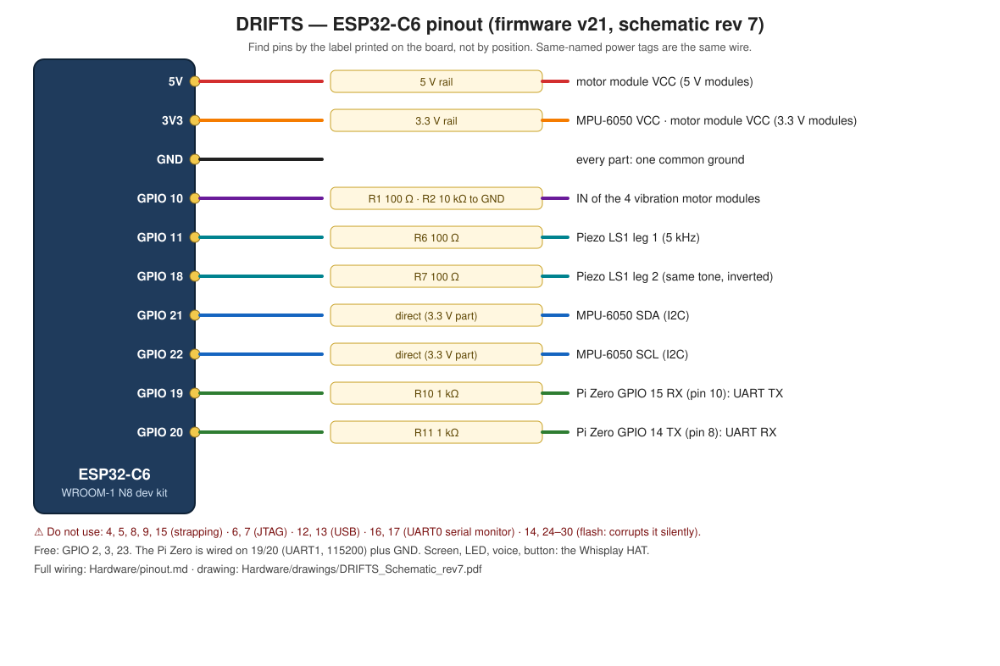

# Pinout (first model)

Every wire, as of **ESP32 firmware v21** and **schematic rev 7**:

| Board | Drives |
| --- | --- |
| **ESP32-C6** | OBD (BLE), MPU-6050, piezo buzzer, vibration motors: the alert, which works on its own |
| **Pi Zero 2 W + Whisplay HAT** | camera, driver screen, RGB LED, voice, button. Wired to the ESP32 by 3 UART wires |

Whole-system drawing: [`drawings/DRIFTS_Schematic_rev7.pdf`](drawings/DRIFTS_Schematic_rev7.pdf)
(PNG alongside). Both drawings are generated:
`python Hardware/drawings/draw_schematic.py` and `python Hardware/drawings/draw_pinout.py`.

---

## ESP32-C6

Find pins by the **label printed on the board** (`5V`, `3V3`, `G`/`GND`,
`10`, `11`, `18`, `19`, `20`, `21`, `22`), not by position. Clone boards with the
CH343 USB chip place pins differently from the Espressif DevKitC.

| ESP32-C6 pin | Goes to | Through | Firmware constant |
| --- | --- | --- | --- |
| **5V** | **In:** Pi pin 2 or 4 (5V), the single 5 V input. **Out:** VCC of all 4 motor modules (with C1 470–1000 µF) | — | — |
| **3V3** | MPU-6050 VCC, motor module VCC (3.3 V modules) | — | — |
| **GND** | Everything: one common ground | — | — |
| **GPIO 10** | **IN** of all 4 vibration motor modules | R1 100 Ω; R2 10 kΩ IN-to-GND | `MOTOR_PIN` |
| **GPIO 11** | Piezo LS1 pin 1 | R6 100 Ω | `PIEZO_A_PIN` |
| **GPIO 18** | Piezo LS1 pin 2 (neither leg to GND) | R7 100 Ω | `PIEZO_B_PIN`: the same signal as 11, inverted |
| **GPIO 21** | MPU-6050 SDA | — | `IMU_SDA_PIN` |
| **GPIO 22** | MPU-6050 SCL | — | `IMU_SCL_PIN` |
| **GPIO 19** | Pi Zero **GPIO 15 RX** (pin 10) | R10 1 kΩ | `PI_UART_TX_PIN`: UART1 TX, 115200 |
| **GPIO 20** | Pi Zero **GPIO 14 TX** (pin 8) | R11 1 kΩ | `PI_UART_RX_PIN`: UART1 RX |

`python3 Hardware/check_pins.py` checks this table (from `pinout.csv`) against
`config.h` and the reserved-pin list. It must print `OK: 7 pins agree`.

### Parts on the ESP32

| Part | Wiring |
| --- | --- |
| **MPU-6050 (GY-521)** | VCC → 3V3, GND → GND, SDA → GPIO 21, SCL → GPIO 22, AD0 → GND (address 0x68). It's a 3.3 V part: no level shifter. Test: `I2C SCAN` lists `0x68` |
| **4 motor modules** (GND, VCC, IN) | IN of all four ← R1 100 Ω ← GPIO 10, with R2 10 kΩ from IN to GND (holds them off during reset). VCC → **5V** (3V3 can't start four motors alongside the ESP32; 3 V motors: lower `DROWSY_VIB_DUTY`), GND → GND |
| **Piezo LS1** (passive) | GPIO 11 → R6 100 Ω → LS1 pin 1. LS1 pin 2 → R7 100 Ω → GPIO 18. Neither leg to GND, no flyback diode |
| **Pi Zero link** (UART, firmware v21) | GPIO 19 → R10 1 kΩ → Pi pin 10 (GPIO 15 RX). Pi pin 8 (GPIO 14 TX) → R11 1 kΩ → GPIO 20. ESP32 GND ↔ Pi pin 6. Both 3.3 V: no level shifter. **TX to RX**, twisted together, away from the motor wires. Test: `STATUS` on the ESP32 console shows `wire=1` once the Pi runs |

**Free ESP32 pins:** 2, 3, 23 (and 0, 1, which are the 32 kHz crystal
pads on some boards; check before using them).

### Do not use

| GPIO | Why |
| --- | --- |
| 4, 5, 15 | Strapping pins |
| 6, 7 | Pad JTAG |
| 8 | Strapping pin + on-board RGB LED |
| 9 | Strapping pin + BOOT button |
| 12, 13 | Native USB D− / D+ |
| 16, 17 | UART0 TX / RX to the CH343 USB chip (serial monitor) |
| 14, 24–30 | Not bonded out / SPI flash. These corrupt the flash silently; never use them, even though ESP32-WROOM-32 reference circuits do |

The authoritative list is [`reserved_pins.csv`](reserved_pins.csv).

---

## Pi Zero 2 W + Whisplay HAT

The **Whisplay HAT plugs onto all 40 header pins**: no wires. The camera uses
the separate CSI ribbon connector. Full datasheet, screens, LED and button
behaviour: [`whisplay-hat.md`](whisplay-hat.md).

| Physical pin | GPIO | Whisplay function |
| --- | --- | --- |
| 19 / 23 / 24 | 10 / 11 / 8 | LCD SPI0 MOSI / SCLK / CE0 |
| 13 / 7 / 15 | 27 / 4 / 22 | LCD data-command / reset / backlight (LOW = on) |
| 22 / 18 / 16 | 25 / 24 / 23 | RGB LED red / green / blue (LOW = lit) |
| 11 | 17 | Button (HIGH = pressed) |
| 12 / 35 / 38 / 40 | 18 / 19 / 20 / 21 | Audio I2S |
| 3 / 5 | 2 / 3 | Audio codec I2C1 |
| 2, 4 / 6 | 5V / GND | Power from the Pi to the HAT, **and to the ESP32's 5V / GND** (single 5 V input, `schematic.md` §5c) |
| **8 / 10** | **14 / 15** | **Not the HAT: the UART to the ESP32** (TX → ESP32 GPIO 20, RX ← ESP32 GPIO 19, each via 1 kΩ). The HAT leaves these pins free |

**UART setup on the Pi** (`deploy/install.sh` does it): `enable_uart=1` and
`dtoverlay=disable-bt` in `/boot/firmware/config.txt` (the Pi no longer needs
Bluetooth; this puts the full UART on pins 8/10 as `/dev/serial0`), and the
serial login console turned off. The car program reads `[link] kind = "uart"`
in `config.toml`.

**Power for the Pi Zero + HAT:**
- **One 5 V input for everything:** a 5 V **3 A** USB supply into the Pi's micro-USB;
  the ESP32 and motors take 5 V from Pi pin 2 or 4 ([`schematic.md` §5c](schematic.md)).
  Never plug the ESP32's USB-C into a laptop while that 5V wire is connected.
- In the car, a USB car charger (5 V 3 A) does the same; wiring to raw 12 V instead needs the 12 V → 5 V buck converter (3 A) on the Pi's 5V/GND
  pins. The speaker's current bursts are on the Pi side.

---

More detail:
- [`schematic.md`](schematic.md): the circuits.
- [`wiring-check.md`](wiring-check.md): checks before power-on.
- [`whisplay-hat.md`](whisplay-hat.md): the driver screen.
- [`../Tokyo/Docs/wiring.md`](../Tokyo/Docs/wiring.md): Tokyo (Pi 5) wiring.
