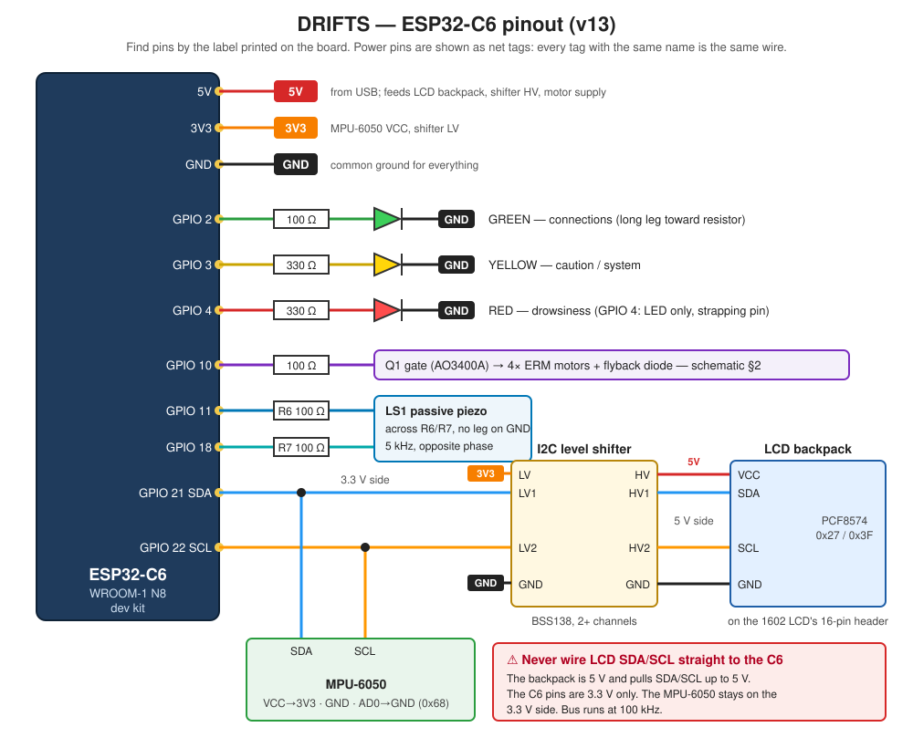

# ESP32-C6 Pinout

Every wire to the ESP32-C6, as of firmware **v13** (LEDs + LCD + differential piezo).

Find pins by the **label printed on the board** (`5V`, `3V3`, `G`/`GND`, `2`,
`3`, `4`, `10`, `11`, `18`, `21`, `22`), not by position. Clone boards with the
CH343 USB chip place pins differently from the Espressif DevKitC.

---

## Pin table

| ESP32-C6 pin | Goes to | Through | Firmware constant |
| --- | --- | --- | --- |
| **5V** | LCD backpack VCC, level shifter HV | — | — |
| **3V3** | MPU-6050 VCC, level shifter LV | — | — |
| **GND** | Everything: LEDs, MPU-6050, shifter (both GND pins), backpack, MOSFET sources | — | — |
| **GPIO 2** | Green LED anode → cathode to GND | 100 Ω (330 Ω if yellow-green) | `LED_GREEN_PIN` |
| **GPIO 3** | Yellow LED anode → cathode to GND | 330 Ω | `LED_YELLOW_PIN` |
| **GPIO 4** | Red LED anode → cathode to GND | 330 Ω | `LED_RED_PIN` — LED only, strapping pin |
| **GPIO 10** | Q1 gate → vibration motors | 100 Ω, 10 kΩ gate-to-GND | `MOTOR_PIN` |
| **GPIO 11** | Piezo LS1 pin 1 | R6 100 Ω | `PIEZO_A_PIN` |
| **GPIO 18** | Piezo LS1 pin 2 (neither leg to GND) | R7 100 Ω | `PIEZO_B_PIN` — same signal as 11, inverted |
| **GPIO 21** | MPU-6050 SDA **and** level shifter LV1 | — | `IMU_SDA_PIN` |
| **GPIO 22** | MPU-6050 SCL **and** level shifter LV2 | — | `IMU_SCL_PIN` |

## LCD wiring, pin by pin

Level shifter pin names vary: SparkFun BOB-12009 uses **LV/LV1–4, HV/HV1–4**;
Adafruit 757 uses **LV/A1–4, HV/B1–4**. Low side = 3.3 V side.

| From | To | Wire |
| --- | --- | --- |
| ESP32 **3V3** | Shifter **LV** | power, low side |
| ESP32 **5V** | Shifter **HV** | power, high side |
| ESP32 **GND** | Shifter **GND** (both sides if it has two) | ground |
| ESP32 **GPIO 21** | Shifter **LV1** (A1) | SDA, 3.3 V |
| ESP32 **GPIO 22** | Shifter **LV2** (A2) | SCL, 3.3 V |
| Shifter **HV1** (B1) | Backpack **SDA** | SDA, 5 V |
| Shifter **HV2** (B2) | Backpack **SCL** | SCL, 5 V |
| ESP32 **5V** | Backpack **VCC** | power |
| ESP32 **GND** | Backpack **GND** | ground |

The MPU-6050 keeps its existing wires to GPIO 21/22, 3V3 and GND (low side).

> ⚠ **Never connect the backpack's SDA/SCL directly to GPIO 21/22.** The
> backpack pulls them up to 5 V; the C6 pins are 3.3 V only.

---

## Do not use

| GPIO | Why |
| --- | --- |
| 5, 15 | Strapping pins |
| 6, 7 | Pad JTAG |
| 8 | Strapping pin + on-board RGB LED |
| 9 | Strapping pin + BOOT button |
| 12, 13 | Native USB D− / D+ |
| 16, 17 | UART0 TX / RX to the CH343 USB chip (serial monitor) |
| 4 | Strapping pin — used for the red LED and **nothing else** |

The authoritative list is [`reserved_pins.csv`](reserved_pins.csv);
`python3 Hardware/check_pins.py` checks it against `config.h`.

More detail: [`schematic.md`](schematic.md) (circuits), [`wiring-check.md`](wiring-check.md)
(pre-power checks), [`../Docs/lcd-display.md`](../Docs/lcd-display.md) (LCD bench test).
