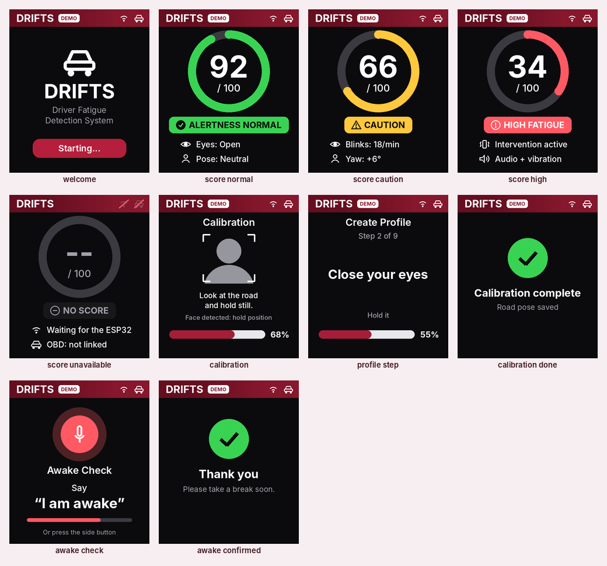

# PiSugar Whisplay HAT on the Pi Zero 2 W (first model)

**Status: the first model's driver display (Nov 2026).** One board on the
Pi Zero gives the driver a 1.69" colour screen, an RGB LED, a speaker and a
button. The software is `Raspberry/drifts/whisplay_ui.py`.

The ESP32 keeps the **buzzer and vibration motors**, so the
alert still fires if the Pi is down (see [Architecture](#architecture)).

Sources: the PiSugar product page and wiki, and the pin definitions in
PiSugar's driver (`runtime/whisplay.py` in github.com/PiSugar/Whisplay).
Values PiSugar doesn't publish are marked *not published*.

---

## Datasheet

| Item | Value |
| --- | --- |
| Board | **65 × 30 mm**, the Pi Zero footprint; plugs onto the 40-pin header and stacks on top |
| Height / weight | *not published*. Measure it when it arrives, for the enclosure |
| Display | **1.69" IPS LCD, 240 × 280 px**, 16-bit colour, rounded corners (about 20 px) |
| Active area | about **30 × 37 mm** (retailer figure) |
| Display controller | **ST7789P3**, 4-wire SPI (mode 0); PiSugar's driver runs it at up to **100 MHz** on the Pi |
| Backlight | GPIO controlled: brightness by software PWM (newer boards) or on/off (older); **LOW = on** |
| Audio codec | **WM8960** (I2S audio + I2C control) on the listed board; PiSugar's unified driver also supports an **ES8389** variant. 48 kHz; ALSA card name `whisplaysound` either way |
| Speaker | **Onboard mono speaker**, plus a **PH2.0 2-pin socket** for an external speaker, with a switch between them. Power *not published*; the WM8960's class-D amplifier is typically up to about 1 W into 8 Ω |
| Microphones | 2 onboard (not used by DRIFTS yet) |
| RGB LED | 1, red/green/blue on separate GPIOs, brightness by software PWM; **LOW = lit** (the driver's "off" state is HIGH) |
| Button | **1 push button**, **HIGH = pressed**, no pull-up needed (pull-down on the board) |
| "Joy" variant | also has a **5-way joystick** (up/down/left/right/centre), active-low with internal pull-ups. Check which version you got |
| Power | from the Pi's 5 V / 3.3 V header pins; current *not published*. Budget about 0.1 A for the screen and up to about 0.5 A at loud audio |
| Works with | Pi Zero / Zero 2 W / Pi 5 (official page) |

---

## Pinout (40-pin header)

| Physical pin | GPIO (BCM) | Whisplay function | Direction |
| --- | --- | --- | --- |
| 19 | GPIO 10 | LCD SPI MOSI (SPI0) | out |
| 23 | GPIO 11 | LCD SPI SCLK (SPI0) | out |
| 24 | GPIO 8 | LCD SPI CE0 | out |
| 13 | GPIO 27 | LCD data / command (DC) | out |
| 7 | GPIO 4 | LCD reset (RST) | out |
| 15 | GPIO 22 | LCD backlight (LOW = on) | out |
| 22 | GPIO 25 | RGB LED red (LOW = lit) | out |
| 18 | GPIO 24 | RGB LED green (LOW = lit) | out |
| 16 | GPIO 23 | RGB LED blue (LOW = lit) | out |
| 11 | GPIO 17 | **Button** (HIGH = pressed) | in |
| 12 | GPIO 18 | I2S BCLK (audio) | out |
| 35 | GPIO 19 | I2S LRCLK (audio) | out |
| 38 | GPIO 20 | I2S data in (microphones) | in |
| 40 | GPIO 21 | I2S data out (speaker) | out |
| 3 | GPIO 2 | I2C1 SDA (WM8960 control) | bidir |
| 5 | GPIO 3 | I2C1 SCL (WM8960 control) | out |
| 2, 4 / 6, 9 … | 5V / GND | power | |
| 1, 17 | 3V3 | power | |
| *Joy variant:* 32, 33, 31, 29, 37 | GPIO 12, 13, 6, 5, 26 | joystick up, right, down, left, centre (active-low) | in |

**What's left free on the Pi Zero:** GPIO 14/15 (UART: since firmware v21 the wired link to the ESP32), GPIO 0/1 (HAT
EEPROM, reserved), GPIO 7, 9, 16. On the plain (non-Joy) version, GPIO 5, 6,
12, 13 and 26 are free too. The camera is on the separate CSI ribbon, so it
doesn't conflict.

**Tokyo (Pi 5) conflicts.** The Whisplay is *not* a drop-in for Tokyo's Rev 9
wiring:
- GPIO 10 is Tokyo's LED strip (SPI MOSI).
- GPIO 18 is Tokyo's buzzer.
- On the Joy variant, GPIO 12 and 13 are Tokyo's IR LEDs and motors.

Tokyo would need pin changes first.

---

## Screen (240 × 280, portrait)



*Rendered by `python -m drifts.whisplay_ui --gallery` with example data
(the DEMO tag in the header). Inter font (`fonts-inter`), dark background,
burgundy header.*

**Colours follow the ESP32's level,** so the screen always agrees with the
buzzer and motors (rules in `Raspberry/drifts/ui_model.py`):

| Score | Ring and label |
| --- | --- |
| 70–100 | green, `ALERTNESS NORMAL` |
| 50–69 (Intervention 1) | yellow, `CAUTION` |
| below 50 (Intervention 2) or the drowsy alert | red, `HIGH FATIGUE`, "Intervention active" |
| no score, or the ESP32 status is older than 5 s | grey ring, `NO SCORE` (never green) |

The ESP32 has 5 points of hysteresis, so a score of 72 can still be yellow
while it recovers. A partial score (no eye data) draws the ring dimmer.

**Screens.** A status display: the screen picks itself, and the driver does
everything else in the phone app (no menus, no assistant on the LCD).

| Screen | Shows | When |
| --- | --- | --- |
| **Welcome** | DRIFTS, "Starting..." | first 4 s |
| **Score** | ring gauge, label, two readings: eyes and pose (OK), blinks and yaw (caution), intervention (high). Without the camera: driving score, speed, OBD | always, after the welcome |
| **Calibration** | quick: head guide, "Look at the road and hold still", progress. Profile / accuracy test: the current pose in large text, step *n* of 9, hold bar. Then "Calibration complete" for 3 s | while a calibration started **in the phone app** runs |
| **Awake Check** | mic, "Say 'I am awake'", 10 s countdown; then "Thank you" | an alert has lasted 20 s (Level 3 check-in) |

An alert always shows the score (or the awake check), never a calibration.

No screen shows a made-up reading. Missing values are `--`; demo data
always carries the DEMO tag.

**Where the data comes from:**
- **In the car program** (`python -m drifts`): the ESP32's 1 Hz status over
  the UART wire (firmware v21; BLE also works): score, level, alert, partial
  flag, driving score, RPM, speed, throttle, OBD state.
- **With the camera pipeline:** `python -m drifts.live --face mesh --esp uart --whisplay`
  adds eyes, PERCLOS, blink rate, head pose and calibration.
  `--whisplay-sim` runs it without the HAT.

## RGB LED

The only status light in the first model:

| Colour | Meaning |
| --- | --- |
| Green, solid | OBD dongle and ESP32 linked |
| Yellow, solid | Intervention 1 |
| Red, 1 s on / 1 s off | Intervention 2 / drowsy alert (in step with the buzzer) |
| Red, slow blink | Connection lost |
| Blue, breathing | Booting / screen locked |

## Button

The side button is programmable: short press, long press (1.5 s) and
double press each run an action set in `config.toml` (`[whisplay]
button_short / button_long / button_double`). Actions and setup:
[`../Docs/whisplay-bringup.md`](../Docs/whisplay-bringup.md#the-side-button).

It is a **developer** button: the driver doesn't need it.

| Press (defaults) | Action |
| --- | --- |
| **Short press** | nothing (`none`), so a stray press does nothing |
| **Any press during the awake check** | Answers "I am awake" (the backup until the voice reply exists) |
| **Any short or double press during an alert** | **Acknowledge**: logged, the screen shows "Acknowledged", and the Level 2 voice repeat pauses for 60 s. This one can't be remapped |
| **Long press (≥ 1.5 s)** | Repeat the last voice message |
| **Double press** | Re-take the road pose (calibration), with the camera pipeline |

**Safety rule:** no button press stops an alert while the driver is still
scored as drowsy. The ESP32's buzzer and motors keep running; only the
Pi's voice repeat pauses.

## Architecture

```
            UART status (score, level, links) ──►┐
 OBD ─BLE─► ESP32-C6 ──► buzzer, motors          │   (alert still works if the Pi is down)
                ▲                                  ▼
                └── EYE score, PING ◄── Pi Zero 2 W + Whisplay HAT ──► colour LCD, RGB LED, speaker, button
                                    └── Arducam (CSI)
```
- **The Pi now drives the screen and voice.** If the Pi is booting or has
  crashed, they stop. The ESP32's buzzer and motors still fire, so keep
  them wired.
- **ESP32 firmware v21** has no display code. It sends its status JSON over the
  UART to the Pi (and over BLE to a phone), so the Pi's link also carries the
  screen's data.
- **Voice clips:** the WAVs in `Voice/clips/`, played by
  `aplay -D plughw:CARD=whisplaysound`, with the rules in
  [`Docs/voice.md`](../Docs/voice.md).
- **Pi Zero load:** the screen updates about once a second and audio is
  occasional, so it should add only tens of MB and a little CPU. Measure it,
  since it competes with the future goal of running the 478-point face mesh on
  the Zero.

## Install and first test

Step by step, with what to expect at each step, in
[`../Docs/whisplay-bringup.md`](../Docs/whisplay-bringup.md). In short:

```bash
cd ~/drifts/Raspberry && WHISPLAY=1 bash deploy/install.sh && sudo reboot
.venv/bin/python -m drifts.whisplay_check --hw     # screen, backlight, LED, speaker, mic, button
.venv/bin/python -m drifts.whisplay_ui --browse    # try the button on every screen
```

Afterwards, measure and note here: the height with the HAT on, speaker
loudness in the car, and the current draw (USB meter) when idle and while
speaking.

## Open items
- [ ] Which version arrived: plain or **Joy**, V1 or V2, WM8960 or ES8389? PiSugar warns that V1's button circuit carries 5 V. That only matters on two non-Pi boards (Orange Pi Zero 3W, Radxa Cubie A7Z), not on the Raspberry Pi.
- [ ] Onboard speaker loud enough over road noise, or an external 8 Ω speaker on the PH2.0 socket?
- [ ] Enclosure cut-out for the 30 × 37 mm screen, mounted where the driver can glance at it.
- [ ] Backlight dimming at night (fixed `brightness` for now).
- [ ] First run on the real HAT: check the screen orientation, the LED colours and the button.
