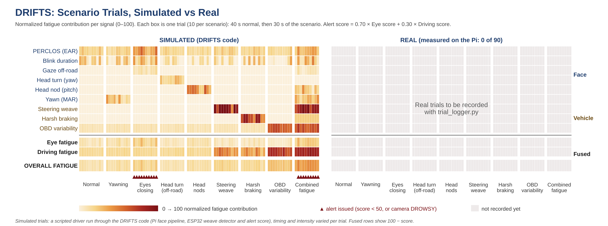

# Scenario trials: simulated vs real

One heat map, two panels: **simulated** trials (left) and **real** trials
measured on the Pi (right). Rows are the scenarios, grouped Face / Vehicle;
columns are trials 1-N. Each box is that trial's 0-100 score for the signal
the scenario tests (named under each row), so a row of boxes shows how
repeatable the response is; ▲ marks a trial in which the alert fired.



| File | What it does |
| --- | --- |
| `scenarios_sim.py` | Runs every scenario N times (default 10) through the real code: the Pi's `FaceMeshSource` and `DrowsyTrigger`, and the ESP32's `weave.h` and `alertness.h` (compiled from `esp_drive.cpp` with g++). Writes `sim_trials.csv` |
| `trial_logger.py` | Records one **real** trial from a running `drifts.live` (`/status.json`) in the same format. Appends to `real_trials.csv` |
| `plot_trials.py` | Draws `scenario_trials.png` from both CSVs; trials not yet recorded are hatched |

```bash
python Tools/scenario_trials/scenarios_sim.py 10     # simulated, 10 trials per scenario
python Tools/scenario_trials/plot_trials.py           # -> Tools/scenario_trials/scenario_trials.png
```

## Scenarios

| Scenario | What the driver does in the 30 s | Expected signal |
| --- | --- | --- |
| `normal` | eyes on the road, normal blinks, mouth relaxed, normal driving | none (baseline) |
| `yawning` | 1–2 yawns, 4–7 s each | Mouth open, Yawn |
| `eyes_closing` | 2–4 eye closures, 1–3.5 s each | PERCLOS, Blink, Gaze; alert if a closure lasts ≥ ~2.6 s |
| `head_turn` | head turned 25–45° off the road, 2 × 3–8 s | Head turn (yaw) |
| `head_nods` | head drops 15–20°, 2–4 × 1–2 s | Head nod (pitch) |
| `steering_weave` | 5–9 drift-and-correct swings | Steering weave |
| `harsh_braking` | 2–4 firm brakes (≥ 0.35 g) | Harsh braking |
| `obd_variability` | uneven speed and throttle | OBD variability |
| `combined` | closures + a yawn + 2 nods + weave, a brake, uneven throttle | everything |

## Recording real trials

1. On the Pi: `.venv/bin/python -m drifts.live --face mesh --esp uart --whisplay`
2. From the Pi or a laptop on the same Wi-Fi, once per trial:
   ```bash
   python Tools/scenario_trials/trial_logger.py --scenario eyes_closing --trial 1 --url http://192.168.1.175:8080
   ```
   Press Enter, behave normally for the 40 s warm-up, then do the scenario when it says **START**.
3. Repeat for trials 1–10 (or up to 20) of each scenario, then `python Tools/scenario_trials/plot_trials.py`.

**Safety:** eye closures, head turns and nods only by a passenger, or in a
parked car. Steering weave and harsh braking on a test rig, on the bench (twist
or tip the enclosure), or on an empty, safe road with a second person driving.

**How each value is computed** (same in both panels): face rows are the mean
drowsiness part (0–100) over the 30 s; steering weave, harsh braking and OBD
variability are the firmware's ratios to its trigger levels (6 reversals / 60 s,
3 brakes / 60 s, RPM 400 / speed 8 / throttle 15 standard deviation), capped at
1.5 and shown 0–100; fused rows are 100 − the score; "Alert fired" is whether
the buzzer and seat started during the scenario. Real steering and braking come
from the ESP32's telemetry (`steer`, `g`), read once a second.

## Real repeatability heat maps (laptop camera or the Pi)

`heat_recorder.py` records the face rows of the poster's heat maps from the running app:
Test 1-4, each 40 s warm-up then ten 6 s boxes from baseline to fatigue, with a prompt for
each box. `plot_heat.py` draws them (tagged MEASURED; tests not yet recorded are grey).

```bash
# terminal 1, from the repo's Raspberry folder (laptop webcam)
python -m drifts.live --face mesh --camera 0 --esp sim --mirror --http-port 8090
#   for the glasses row add: --glasses on   (wear glasses or sunglasses)

# terminal 2, from the repo folder: one run per test (1-4) per row
python Tools/scenario_trials/heat_recorder.py --row eyes --test 1 --url http://localhost:8090
python Tools/scenario_trials/plot_heat.py      # -> Tools/scenario_trials/heat_<row>.png
```

Rows: `head` (nods / droop), `eyes` (EAR, PERCLOS, blinks), `yawns` (MAR), `glasses`
(head turn off-road with glasses on). Each box is the mean 0-100 drowsiness part of that
signal over the 6 s; ▲ = the app sent DROWSY (the alert) in that box.
